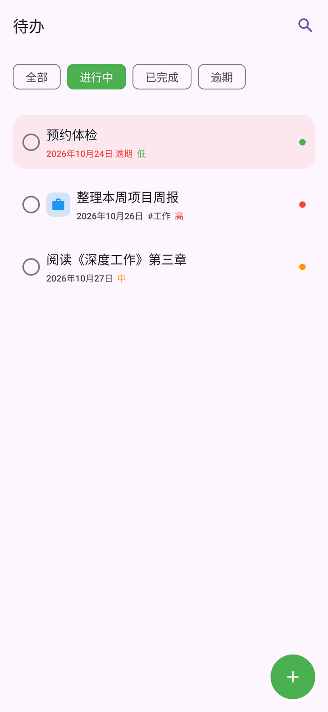
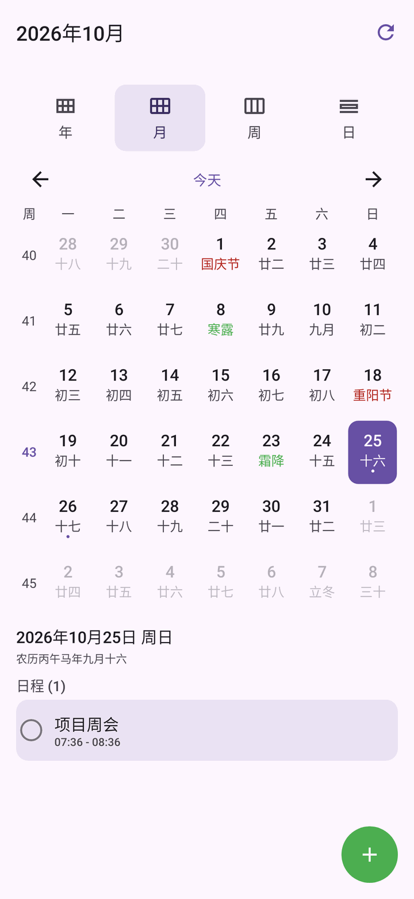
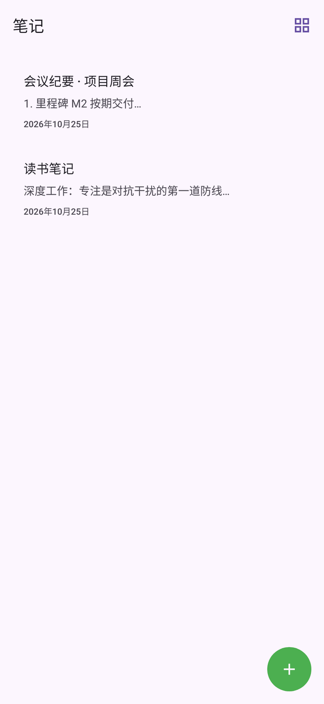
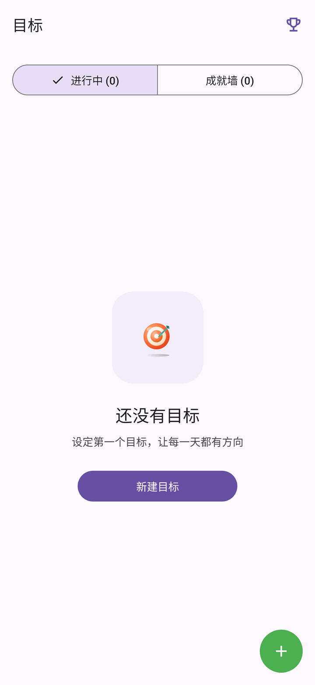
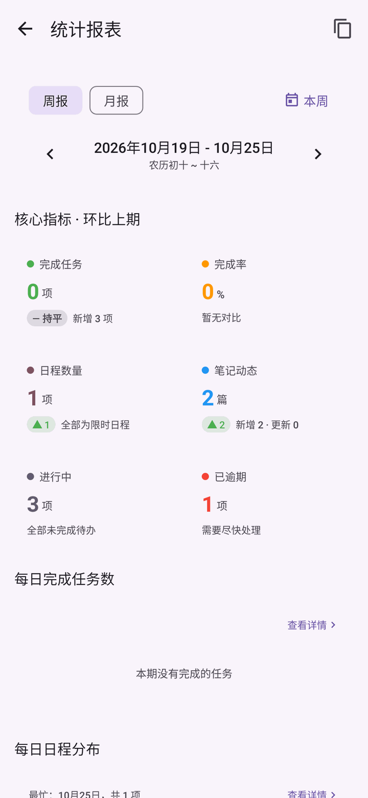
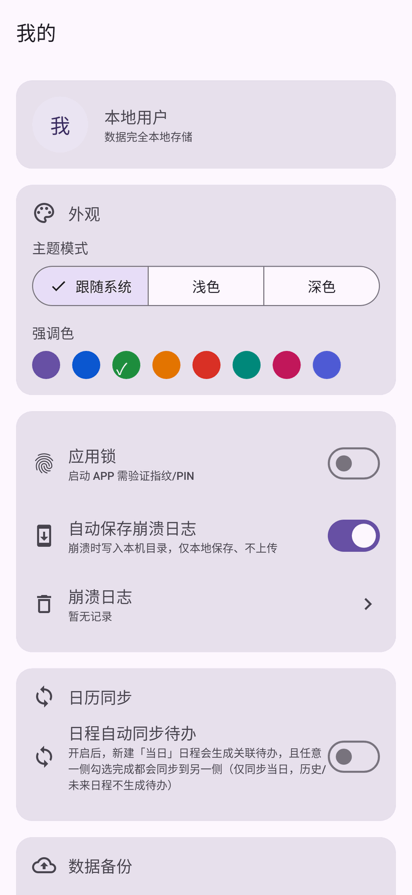
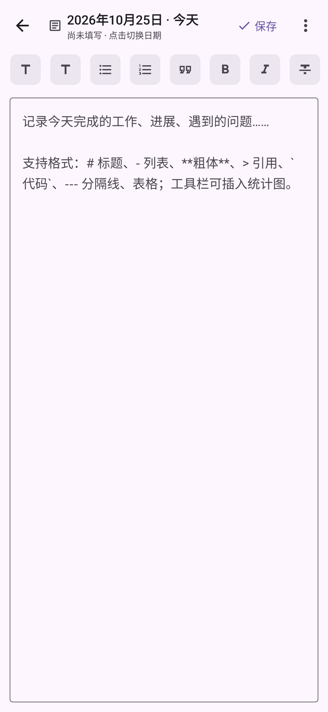

# 个人工作台 APP（Personal Workbench）

[](https://github.com/siyu666888/PersonalWorkbench/actions/workflows/ci.yml)
[](LICENSE)

> 一站式个人效率中心 —— 让笔记、任务、日程、目标、项目和文件在同一个工作台内无缝流转。
> 依据《个人工作台APP_PRD.docx》《个人工作台APP_UI设计规范.docx》《个人工作台APP_Figma标注导出规范.docx》开发。

## 〇、应用演示

<p align="center">
  
</p>

| 首页 | 待办 | 日程 | 笔记 |
| :---: | :---: | :---: | :---: |
|  |  |  |  |

| 目标 | 统计报表 | 我的 | 日志填写 |
| :---: | :---: | :---: | :---: |
|  |  |  |  |

> 截图由 `ScreenshotGeneratorTest`（Robolectric 原生图形模式）在 JVM 内真实渲染生成，
> 预置了演示数据以便直观看到界面状态。重新生成：
> `./gradlew :app:testDebugUnitTest --tests "ScreenshotGeneratorTest"`

## 一、技术栈

| 维度 | 选型 | 依据 |
| --- | --- | --- |
| 语言 / UI | Kotlin + Jetpack Compose（Material 3） | PRD 5.1 |
| 架构 | MVVM + Repository（Offline-First，本地数据库为唯一数据源） | PRD 5.2 |
| 数据库 | Room（SQLite） | PRD 5.3 |
| 偏好设置 | DataStore Preferences | PRD 5.1 |
| 依赖注入 | 手动 DI（`AppContainer`） | PRD 5.1「Hilt 可选」 |
| 异步 | Coroutines + Flow | PRD 5.1 |
| 导航 | Navigation Compose | PRD 5.1 |
| 文件 | SAF（Storage Access Framework）| PRD 5.1 |
| 提醒 | WorkManager（一次性延迟任务 + 每日周期任务）+ 本地通知 | V1.3.2 起由 AlarmManager/BroadcastReceiver 改为 WorkManager，无需精确闹钟权限 |
| 图片加载 | Coil | PRD 6.3 |
| 最低版本 | minSdk 26（Android 8.0）/ targetSdk 34 | PRD 6.2 |
| 包体积 | release 实测 **2.99 MB**（R8 混淆 + 资源压缩，远低于 30 MB 目标） | PRD 6.1 |
## 二、目录结构

```
app/src/main/java/com/example/personalworkbench/
├── PersonalWorkbenchApp.kt          # Application（持有 AppContainer）
├── MainActivity.kt                  # 入口 + 底部导航 + NavHost + 备份提醒
├── data/
│   ├── local/                       # Room：entities / dao / AppDatabase / Converters
│   ├── preferences/                 # DataStore 用户偏好（主题/应用锁/备份提醒）
│   └── repository/                  # 各模块 Repository（业务规则在此）
├── di/AppContainer.kt               # 手动 DI 容器
├── reminder/ReminderReceiver.kt     # 本地提醒通知
├── ui/
│   ├── theme/                       # 设计系统：颜色/字体/圆角（严格对应 Token）
│   ├── navigation/                  # 路由定义
│   ├── components/                  # 通用组件：空状态/对话框/优先级点/环形进度/筛选 Chip
│   ├── home/ todo/ notes/ calendar/ goals/ files/ reports/ settings/   # 各业务页面
│   ├── engineering/                 # 工程管理（项目列表/详情/里程碑甘特图）
│   ├── search/                      # 全局搜索聚合页
│   ├── ai/                          # AI 智能助手对话页
│   └── security/                    # 应用锁拦截网关
├── util/                            # 日期/文件/备份/农历/重复规则工具
└── viewmodel/                       # 各页面 ViewModel
```

## 三、已实现范围（V1.0 MVP · P0）

| 模块 | 已实现 | 说明 |
| --- | --- | --- |
| 工作台首页 | ✅ | 问候语、今日焦点（待办/日程/逾期，点击主页 Tab 即时刷新）、快捷入口 2×4（待办/笔记/日程/目标/文件/项目/报表，各项带实时数量徽标）、最近动态、快速添加、AI 助手入口 |
| 待办管理 | ✅ | 列表 + 筛选（全部/进行中/已完成/逾期）、**子任务折叠展开**、子任务、优先级、创建/编辑（标题/描述/截止日期/优先级）、左滑删除、回收站（7 天自动清理）、父子任务联动完成 |
| 笔记记录 | ✅ | 列表/宫格切换、富文本编辑器（Markdown 工具栏：加粗/标题/列表/引用/代码块/链接/图片）、输入停止 1 秒自动保存 |
| 日程管理 | ✅ | 月视图（周一为首日）、月切换、当日日程、待办联动、新建/删除日程；**周期性日程**（每天/每周/每月/每年，含间隔、每周多选星期、按次数或日期结束）+ **农历/节气/节假日**标注 |
| 统计报表 | ✅ | 周报/月报切换与上下期导航，KPI 卡、每日完成/日程柱状图、环比完成率对比、目标进度、工程概览、农历节令亮点，一键复制文字版 |
| 目标管理 | ✅ | 数值型/习惯型/里程碑型三类型、环形进度、打卡/补签/记录数值、子里程碑、成就墙 |
| 文件收纳 | ✅ | SAF 导入、分类筛选（图片/文档/PDF/音频）、列表、删除、卸载丢失警告横幅 |
| 设置 | ✅ | 主题（跟随系统/浅色/深色）、强调色、应用锁开关、崩溃日志开关、导出备份/恢复（zip）、回收站入口、关于 |
| 工程管理 | ✅ | 项目列表（进行中/已归档）、项目详情（概览/里程碑/资源/问题/日报 5 个 Tab）、进度滑杆、状态切换、里程碑/资源/问题/施工日报 CRUD、删除项目级联清理关联数据 |
| 里程碑甘特图 | ✅ | 项目详情「里程碑」Tab 内按 planDate 排期的时间轴（以项目起止日期为基准定位每个里程碑） |
| 周/日日程视图 | ✅ | 日程页支持 月/周/日 三视图；周视图 7 日条带 + 按时段排序列表；日视图 24 小时时间轴 + 全天日程 |
| 应用锁实校验 | ✅ | 启动与从后台返回均拦截，BiometricPrompt 指纹/设备 PIN 验证通过后才进入；无可用凭证时优雅放行 |
| 全局搜索 | ✅ | 首页搜索入口 + 聚合检索页，跨 待办/笔记/文件/工程/目标 统一检索，结果点击直达对应详情 |
| AI 智能助手 | ✅ | 首页 AI 入口卡片 + 对话页（路由 aiChat）；**默认纯本地离线问答**（今日待办/逾期/本周日程/目标/工程项目），不联网、数据不出本机 |

工程管理模块（V1.5 · P1）：数据层（projects / milestones / resources / issues / daily_reports 实体 + DAO + Repository）与 UI（项目列表 + 项目详情 5 Tab + 甘特图）均已完整实现。

## 三·一、V1.1 设计与体验更新

- **应用图标重设计**：自适应图标 foreground 改为「白色圆角对话气泡 + 紫色星火」的 AI 对话意象，background 改为浅紫→深紫线性渐变（`drawable/ic_launcher_foreground.xml` / `ic_launcher_background.xml`）。
- **配色体系完善**：强调色预设由 5 色扩展为 8 色（紫/蓝/绿/橙/红/青/粉/靛），并真正应用到 Material 3 主题（`PersonalWorkbenchTheme(accentIndex)` 覆盖 primary 系列色阶）；新增 AI 语义色（`SemanticColors.ai` / `aiContainer`，浅色/深色各一套），全站统一通过 `LocalSemanticColors` 取用。

## 三·二、V1.2 更新

- **底部主页按钮修复 + 今日焦点刷新**：再次点击底部「主页」Tab 会刷新首页；`HomeViewModel` 的「今日」查询改为按当前日期动态计算（`dayTick` + `refresh()`），跨天或点击主页 Tab 即重算，今日焦点/今日日程数量及时更新。
- **待办子任务折叠**：有待办任务的父任务卡片显示「N ▸」，点击展开/折叠其子任务（缩进 + 复选框，可单独完成/进入详情）。
- **快捷入口数量徽标**：首页 6 个快捷入口（待办/日程/笔记/目标/文件/项目）各自显示实时数量。
- **版本号**：`versionName 1.2.0 / versionCode 3`；「我的-关于」改为读取 `BuildConfig.VERSION_NAME` 动态展示（已开启 `buildConfig`）。

## 三·三、V1.2.1 修复

- **底部「首页」按钮偶发无响应**：根因是点击处理读取的组合状态 `currentRoute` 在页面切换过渡期间可能滞后，导致“是否重复点击当前 Tab”的判断失误而跳过导航。现改为**始终执行导航**，仅用实时 `navController.currentDestination` 判断是否重复点当前 Tab；从待办/日程/笔记点首页可稳定回到首页。
- **今日焦点刷新增强**：新增 `LifecycleResumeEffect`，切换回首页 / 从后台返回 / 跨天时自动 `refresh()`，今日焦点与今日日程数量保持最新。
- 版本号：`versionName 1.2.1 / versionCode 4`。

## 三·四、V1.2.2 修复

- **里程碑甘特图闪退（严重）**：在项目详情「里程碑」Tab 中，添加多条带计划日期的里程碑后点击该 Tab 必现崩溃闪退。根因：时间轴用 `Modifier.weight(frac)` / `Modifier.weight(1f - frac)` 分配左右空间，当某条里程碑恰为排期起点或终点时 `frac` 为 `0f`/`1f`，而 **Compose 的 `RowScope.weight` 对 `weight <= 0f` 直接抛出 `IllegalArgumentException: invalid weight 0.0; must be greater than zero`**（已通过反编译 `foundation-layout 1.6.8` 的 `RowScopeInstance.weight` 字节码确认）。修复：将 `frac` 收敛到开区间 `coerceIn(0.001f, 0.999f)`，两端 Spacer 权重恒大于 0，偏移量不足 1dp、视觉无感知。
- 版本号：`versionName 1.2.2 / versionCode 5`。

## 三·五、V1.3.0 更新

- **App 启动图标更换**：按用户提供的设计稿替换整套图标。自适应图标（`mipmap-anydpi-v26/ic_launcher.xml`）由**新的浅青渐变背景层**（`drawable/ic_launcher_background.xml`，色标 `#FFF2FCFC → #FFE4F7F9 → #FFA9DFE3`）与**前景 PNG**（`drawable-xxxhdpi/ic_launcher_foreground.png`，432×432，由设计稿提取，主体收敛在中心 62% 安全区内）合成；同时生成 API < 26 回落的 `mipmap-{mdpi,hdpi,xhdpi,xxhdpi,xxxhdpi}/ic_launcher.png` 与 `ic_launcher_round.png` 五档位图（48/72/96/144/192 px）。提取脚本见 `tools/extract_icon_fg.py`（背景建模 + 边缘屏障漫水填充，避免白色书本/人物被误判为背景而挖空）。
- **底部导航彩色拟物图标**：`首页/待办/笔记/日程/我的` 五个 Tab 图标由单色 Material 图标改为**彩色拟物矢量图**（`drawable/ic_nav_*_color.xml`，24×24，使用 `aapt:attr` 线性渐变 + 高光/阴影层）。`TopLevelRoute` 由 `ImageVector` 改为 `@DrawableRes iconRes`，`NavigationBarItem` 以 `painterResource(...)` + `tint = Color.Unspecified` 渲染，保留图标自身配色。
- **周期性日程**：新增重复规则引擎 `util/RecurrenceUtils.kt`（`RepeatFreq = 每天/每周/每月/每年`，支持间隔、每周多选星期、按次数/按日期结束、排除实例 EXDATE），编码为 KV 字符串存入**已存在的** `schedules.repeat_rule` 列（**无需数据库迁移**）。`ScheduleRepository.observeInRange()` 内部把重复系列按查询区间展开成实例，首页/日历/AI 助手等所有调用方自动受益；编辑单次时可保留系列相位（`rebaseToSeriesDate`），删除时支持「仅删除此次 / 删除整个系列」。
- **农历 / 节气 / 节假日**：新增 `util/LunarUtils.kt`（1900–2100 `lunarInfo` 表 + 24 节气 `sTermInfo` 表），提供农历年月日（含闰月）、干支生肖、二十四节气、公历/农历传统节日与法定假日判定。日历页**月视图每格显示公历日 + 农历/节气/节日小字**（节日红、节气绿）、当日头部显示完整农历标签（如「农历丙午马年九月初五」），周视图每日也带农历标注。
- **周报 / 月报可视化报表**：新增报表页（路由 `reports`，首页「快捷入口」新增「报表」入口）。`ReportsViewModel` 用嵌套 `combine` 聚合**待办 / 日程 / 笔记 / 目标 / 工程**五类数据（`kotlinx combine` 单次最多 5 个流，故分三组再合并），输出：核心指标 2×2 KPI 卡（完成数、完成率及环比、日程数、笔记动态、进行中、已逾期）、`Canvas` 绘制的每日完成任务柱状图与每日日程分布柱状图（自适应宽度 + 稀疏 X 轴标签，月报 31 天不重叠）、本期 vs 上期完成率对比条、目标进度条列表、工程概览（平均进度 / 里程碑 / 遗留问题），以及本期农历·节气·节日亮点；右上角可将整份报表**一键复制为纯文字版**便于粘贴到周会记录。
- 版本号：`versionName 1.3.0 / versionCode 6`（V1.3.1 修复版见下节）。

## 三·六、V1.3.1 修复（5 项实时性 / 视觉问题）

本版只做缺陷修复与视觉微调，**未重构任何模块**，技术栈、UI 布局与交互逻辑保持不变。

### 1. 首页「最近动态」不会自动更新

- **根因**：原实现只收集了 `recentNotes`（`LIMIT 2`）与 `activeGoals` 两条流，**待办与日程的变化完全不会出现在该模块**，因此无论怎么改数据都得手动刷新。
- **改动文件**：`viewmodel/HomeViewModel.kt`（重写）、`ui/home/HomeScreen.kt`。
- **实现方式**：新增 `ActivityType` 枚举（TASK/SCHEDULE/NOTE/GOAL）与 `RecentActivity` 数据类，把 tasks / schedules / notes / goals 四条 Room `Flow` 用 `combine` 合并为统一的 `recentActivity` 流 → 取近 30 天窗口 → `sortedByDescending { timestamp }.take(8)`。首页改用 `items(activity, key = { it.id })` 渲染 `ActivityRow`，点击仍按 `type` 跳原路由。由于底层是 Room `Flow`，`InvalidationTracker` 会在表变更时自动重发射，**无需手动刷新**。

### 2. 项目进度不会自动更新

- **根因**（三处）：(a) `@Update` 整行覆盖且从不更新 `updatedAt`，`ORDER BY updated_at DESC` 排序僵死、并发下还会丢更新；(b) 滑杆用 `remember(project.progress)`，拖动过程中会被外部发射打断；(c) 百分比文本取自 `project.progress` 而非滑杆本地值，视觉滞后。
- **改动文件**：`data/local/dao/EngineeringDao.kt`、`data/repository/EngineeringRepository.kt`、`viewmodel/EngineeringViewModel.kt`、`ui/engineering/ProjectDetailScreen.kt`。
- **实现方式**：DAO 新增单列原子写 `@Query("UPDATE projects SET progress = :progress, updated_at = :updatedAt WHERE id = :id")`，Repository 暴露 `updateProgress(id, progress)`（`coerceIn(0,100)` 并补 `updatedAt`），`archiveProject`/`restoreProject` 同样补 `updatedAt`；ViewModel 新增 `updateProgress(progress)`；UI 改为**乐观更新**——`var pv` + `dragging` 标志，`LaunchedEffect(project.progress) { if (!dragging) pv = ... }` 回填，百分比文本用 `pv.toInt()` 实时显示。

### 3. 底部导航图标偏小、比例不协调

- **改动文件**：`MainActivity.kt`。
- **实现方式**：`NavigationBar` 高度 80→**86dp**；图标 24→**28dp**（仍用 `tint = Color.Unspecified` 保留彩色原色）；标签改 `labelMedium` + `fontSize 11.sp / lineHeight 13.sp / letterSpacing 0.4.sp`，`maxLines=1, softWrap=false, overflow=Clip` 防换行；图标与文字间加 3dp `Spacer`、图标列 `padding(top = 4.dp)`。

### 4. 快捷入口图标风格更换（统一拟物化）

- **改动文件**：`ui/home/HomeScreen.kt`（`QuickEntry` 改为 `@DrawableRes iconRes`，`QuickEntryCard` 用 `Icon(painterResource(...), tint = Color.Unspecified, size = 30.dp)`）。
- **新增矢量图**：`res/drawable/ic_quick_goal_color.xml`（拟物靶心 + 飞镖，5 同心圆 radial 渐变）、`ic_quick_file_color.xml`（琥珀文件夹，落影/后挡板/文件/前挡板/高光暗部）、`ic_quick_project_color.xml`（蓝色施工楼体 + 灰蓝塔吊）、`ic_quick_report_color.xml`（数据卡片 + 三色柱状图 + 描边）。
- **复用**：`待办/笔记/日程` 直接复用 V1.3.0 的 `ic_nav_todo_color` / `ic_nav_note_color` / `ic_nav_calendar_color`。**7 个快捷入口现已全部为同风格彩色拟物图标**，尺寸 30dp 与界面一致。

### 5. 今日焦点「今日待办」「今日日程」不同步

- **根因**：`TaskDao.observeToday` 的 SQL 与其自身注释（「今天到期**或**今日创建」）不符，只按 `due_date` 过滤 —— **今天新建但未设截止日期的待办永远不会出现**，看起来就像新增后不同步。
- **改动文件**：`data/local/dao/TaskDao.kt`、`viewmodel/HomeViewModel.kt`。
- **实现方式**：SQL 修正为 `(due_date BETWEEN :dayStart AND :dayEnd) OR (due_date IS NULL AND created_at BETWEEN :dayStart AND :dayEnd)`，并按「有截止日的按 due_date 升序在前、无的按 dayEnd 兜底」排序。`HomeViewModel` 另加 **30 秒跨天心跳**（`dayTick: MutableStateFlow`）：定时检查 `dayStartMillis(now)` 是否变化，跨天即自动重算「今日」区间，无需手动刷新。该 DAO 变更同时惠及 `CalendarViewModel` / `AiAssistantViewModel`（两者本就应显示今日新建项）。

### 验证

`./gradlew testDebugUnitTest assembleDebug` **BUILD SUCCESSFUL**（2m17s），16/16 单测全绿（`LunarUtilsTest` 5 + `RecurrenceUtilsTest` 11）。产物 `app-debug.apk` 19,930,841 bytes，`versionName 1.3.1 / versionCode 7`。其余页面（日程/笔记/报表/我的/搜索/工程列表）逻辑与布局均未改动。

### 6. 发布签名配置 + R8 首次验证（V1.3.1 收尾）

- **改动文件**：`app/build.gradle.kts`、新增 `keystore.properties`、`.gitignore`。
- **签名**：在仓库外生成发布 keystore（`D:/devtools/keystore/personalworkbench-release.jks`，RSA 4096 / PKCS12 / 有效期 10000 天，别名 `personalworkbench`）。`build.gradle.kts` 顶部读取根目录 `keystore.properties`，仅当文件存在时创建 `release` signingConfig，**缺失时自动跳过，debug 构建与拉源码者不受影响**。显式开启 `enableV2Signing` + `enableV3Signing`（minSdk 26 默认只签 v2；API 26/27 设备会自动忽略 v3 块，无兼容性风险）。
- **安全**：`*.jks` / `*.keystore` / `*.p12` / `keystore.properties` 已加入 `.gitignore`，keystore 本体与密码均不在仓库内。**keystore 与密码丢失将无法再更新已发布应用，请另行离线备份。**
- **R8 验证**：`./gradlew assembleRelease` **BUILD SUCCESSFUL**（3m51s），`isMinifyEnabled` + `isShrinkResources` 首次跑通，无崩溃性裁剪。产物 `app-release.apk` **2,885,311 bytes**（debug 为 19.9 MB，缩减约 85%，主要来自 `material-icons-extended` 与 debug 工具的裁切），单 dex、无需 multidex。
- **保留项核查**：`seeds.txt` 确认 `PersonalWorkbenchApp` / `MainActivity` / `AppDatabase` / `HomeViewModel` / `ReportsViewModel` 等入口类全部保留；`resources.txt` 确认 10 个彩色拟物图标（`ic_nav_*_color` ×5 + `ic_quick_*_color` ×4 + 启动图标）均标记 `reachable` 且被 release dex 引用。
- **签名验证**：`apksigner verify --verbose` 通过，v2 / v3 双方案，RSA 4096。
- **崩溃堆栈还原**：`app/build/outputs/mapping/release/mapping.txt`（约 44 MB）为混淆映射，**每次发布需单独归档**，否则线上崩溃堆栈无法还原。

## 三·七、V1.3.2 本地提醒闭环 + 通知权限

上一版遗留的两个发布阻塞项在本版收口：提醒功能此前**只有接收端没有调度端**（`ReminderReceiver` 从未被任何代码调用），且为此白带了两个敏感权限。

### 1. 用 WorkManager 补全调度闭环

**新增文件**（均在 `reminder/` 包）：

| 文件 | 职责 |
|---|---|
| `ReminderNotifier.kt` | 把一条提醒变成系统通知（渠道、点击跳转、样式），由 Worker 调用 |
| `ReminderItem.kt` | 数据模型：`key` / `triggerAt` / `title` / `content` |
| `ReminderPlanner.kt` | **无状态规划器**：读库推导「未来应触发哪些提醒」，不写库、不碰 UI |
| `ReminderScheduler.kt` | 把目标集合与 WorkManager 已排程状态做**增量对齐** |
| `ReminderWorker.kt` | `CoroutineWorker`，到点发通知 |
| `ReminderResyncWorker.kt` | `CoroutineWorker`，读库→规划→对齐 |
| `ReminderSync.kt` | 触发入口（1.5s 防抖）+ 每日周期注册 |

**三个触发时机保证闭环**（`PersonalWorkbenchApp.onCreate`）：

1. **冷启动自愈**——恢复备份、用户清理过 WorkManager 数据等场景重新对齐一次；
2. **数据变更驱动**——Room `InvalidationTracker` 监听 `tasks` / `schedules` / `goals` 三表，覆盖 UI、AI 助手、备份恢复等**所有**写入路径，无需在每个 Repository / ViewModel 里手动调用；
3. **每日周期任务**——跨天后「今天」的区间变了，需要重新规划。

**触发规则**（完全复用既有数据字段，未新增数据库列、无需迁移）：

- 待办：`reminder_on = true` 且有截止日期 → 截止日当天 **09:00**（截止日期按整天存储，定在上午 9 点避免午夜打扰）；
- 日程：`reminder_minutes` 非空即开启，`0` = 准点、`n` = 提前 n 分钟；**周期性日程按区间展开，每个实例独立提醒**（key 含实例开始时间）；
- 目标：`remind_time`（HH:mm）非空且进行中 → **每天**到点提醒，已过则顺延次日。

**增量对齐策略**：用 WorkManager 的 tag 携带触发时刻，只在「新增 / 改期」时 `REPLACE`、「记录被删 / 完成 / 已触发」时 `cancelUniqueWork`，完全一致则不动——避免每次数据变更都重建全部任务。

**取舍说明**：WorkManager 的延迟**不是精确定时**，Doze / 应用待机下可能晚几分钟。这是为彻底避开 `SCHEDULE_EXACT_ALARM`（Google Play 受限权限，需提交用途声明且仅认可闹钟/日历类用途）而主动接受的代价。

### 2. 清理断链代码与多余权限

- **删除** `reminder/ReminderReceiver.kt`（全项目无任何代码调度它，属死代码）及其 Manifest `<receiver>` 声明。
- **移除** `SCHEDULE_EXACT_ALARM`——已无 AlarmManager 使用，且属 Play 受限权限。
- **移除** `FOREGROUND_SERVICE`——本项目没有任何 `Service`；WorkManager 库清单会带入该权限，用 `tools:node="remove"` 在合并期剔除。
- 最终权限清单（合并 Manifest 实测）：`POST_NOTIFICATIONS`、`CAMERA`、`ACCESS_FINE/COARSE_LOCATION`、`USE_BIOMETRIC`/`USE_FINGERPRINT`、`READ/WRITE_EXTERNAL_STORAGE`（带 `maxSdkVersion`），以及 WorkManager 自身需要的 `RECEIVE_BOOT_COMPLETED` / `WAKE_LOCK` / `ACCESS_NETWORK_STATE` / `DUMP` / `BIND_JOB_SERVICE`。

### 3. Android 13+ 通知权限运行时申请

`MainActivity.kt` 新增 `RequestNotificationPermissionOnce()`：API 33+ 且未授权时申请一次；用户连拒两次后系统自动拒绝，不会反复打扰。放在 `AppRoot` 内（`AppLockGate` 之后），避免与应用锁弹窗叠加。API 32 及以下安装时即授予，无需处理。

### 4. 依赖与测试

- 新增 `androidx.work:work-runtime-ktx:2.9.1`（WorkManager 通过 `androidx.startup` 自动初始化，无需 `Configuration.Provider`）。
- 新增 `ReminderPlannerTest`（6 项）：`parseHhMm` 边界值、`atHourOfDay` 时点换算、`nextDailyTrigger` 的「当天 / 顺延次日 / 恰好到点」三种分支。这部分纯时间逻辑最容易因时区与跨天出错，且不依赖 Android 框架。

### 验证

`./gradlew testDebugUnitTest assembleDebug assembleRelease` **BUILD SUCCESSFUL**（3m24s），**22/22 单测全绿**（新增 `ReminderPlannerTest` 6 + `LunarUtilsTest` 5 + `RecurrenceUtilsTest` 11）。

- release 包 `app-release.apk` **2,969,364 bytes**，`versionName 1.3.2 / versionCode 8`，签名 v2 + v3 通过。
- **R8 保留核查**：`ReminderWorker` / `ReminderResyncWorker` 在 `seeds.txt` 中（Worker 由反射实例化，必须是入口点）；对 `classes.dex` 做字符串探测，确认 `reminder_channel`、`任务提醒`、`reminder_resync`、`reminder_resync_daily`、三条表名 `tasks`/`schedules`/`goals`、以及全部提醒文案均在包内。`ReminderNotifier` 在 `mapping.txt` 中标记为 `R8$$REMOVED$$CLASS`——这是 R8 的**垂直类合并**（单例被并入唯一调用方 `ReminderWorker`），逻辑并未丢失，已由上述字符串探测证实。
- 合并 Manifest 实测确认 `SCHEDULE_EXACT_ALARM` 与 `FOREGROUND_SERVICE` 均已剔除、`ReminderReceiver` 无残留。

## 三·八、V1.3.3 排版优化 + 工期进度自动计算 + 崩溃日志 + 日程完成 + 待办折叠

针对「发布前使用反馈」的 5 个问题逐项修复，全部保持既有技术栈、UI 布局与交互逻辑，不重构无关模块。版本号 `versionName 1.3.3 / versionCode 9`。

### 1. 字体大小与排版优化

- **`ui/theme/Type.kt`**：按中文方块字的密度整体上调行高（display/headline/title/body/label 共 9 档），并**新增 `bodySmall` 12/19**、`labelMedium` 由 11sp 抬到 12sp——中文小字号最怕行高不够挤成一团。
- **首页**（`HomeScreen.kt`）：问候语改 `headlineSmall + SemiBold`；日期行降为 `labelMedium` 并加 2dp 上间距；三个区块标题统一抽成 `SectionHeader` 复用；快捷入口图标 30→32dp、卡片 80→76dp、网格高度 356→340dp，消除底部被裁的观感。
- **底部导航**标签 11sp/13sp → 12sp/15sp；**日历**农历小字 8sp→9sp、月视图行高 10→11sp。

### 2. 项目总进度按「工期」自动计算

核心公式（新增 `util/ProjectProgress.kt`）：**总进度 = 已完成工期 / 总工期**

- 总工期 = `planEndDate - startDate`；
- 已完成工期 = max(今日 − 开工日, 已完工里程碑的实际完成日 − 开工日)，即「日历时间进度」与「里程碑实证进度」取大；
- 里程碑**按期**完成时实际完成日 == 计划日，总进度正好等于「已完成的计划工期 / 总工期」；提前/滞后都按**实际完成日**计，不虚报也不瞒报；
- 缺开工/竣工日期（或工期非正）→ 返回 `null`，UI 自动回退到原来的手动滑杆。

`ProjectProgressCalibrator` 是一个按 `projectId` 记账的输入指纹状态机（指纹 = 项目日期与状态 + 当天 + 每个里程碑的状态/计划日/实际完成日）：

- 指纹**变化**（跨天 / 改日期 / 里程碑完成）→ 重算并写库，此时即使用户手动拖动过也会被校准值覆盖——这正是「总进度要跟着实际进展自动调整」；
- 指纹**未变**而库里的值与自动值不符 → 判定为用户手动微调，**尊重手动**，否则用户一松手进度就被弹回、滑杆等于不可用。

自动校准写入走专用通道 `EngineeringDao.updateProgressOnly`（只改 `progress` 一列、**不刷新 `updated_at`**），避免进度漂移打乱列表的「最近更新」排序。详情页 `ProjectHeader` 新增口径说明「总进度按工期自动计算：已完成 X 天 / 总工期 Y 天」；里程碑编辑新增「实际完成日期」字段（切到「已完成」时默认填今天，可再改）。

新增 `ProjectProgressTest` **19 项**：缺日期、工期非正、未开工、过半、超期封顶、里程碑按期/提前/滞后完成、缺实际完成日退回计划日、多里程碑取最远、整体完工拉满，以及校准状态机的首次写入 / 已同步不写 / 尊重手动 / 里程碑完成后覆盖手动 / 跨天重算 / 退回手动口径。

### 3. 崩溃报告自动存到本地

新增 `crash/CrashLogStore.kt` + `crash/CrashReporter.kt`：`Application.onCreate` 安装一个 `Thread.UncaughtExceptionHandler`，先把堆栈写进 `filesDir/crash/crash-<时间戳>.txt`（含应用版本、厂商/型号、系统版本、ABI、线程名与完整异常链），**再交回系统默认处理器**——崩溃体验与系统完全一致（照常弹「已停止」/ 退出），只是多留下一份可事后诊断的本地报告。最多保留 10 份，超出按时间删最旧。

- 只写本机、**绝不上传**；设置页原「崩溃日志上报」开关改名为「**自动保存崩溃日志**」并**默认开启**（DataStore 首个值到达前也按「开」处理——崩溃随时可能发生，宁可多存一份纯本地日志也不要漏掉）。
- 新增 `androidx.core.content.FileProvider`（authority `com.example.personalworkbench.fileprovider`），`res/xml/file_paths.xml` **只暴露 `filesDir/crash/` 一个目录**，数据库/备份/附件等私有文件一律不可被外部应用拿到。
- 设置页新增「崩溃日志」入口：查看全文（等宽小字号 + 滚动）、单份分享（系统分享面板）、单份删除、全部清空。

### 4. 日程可勾选已完成

- `schedules` 表新增 `is_completed` 列（`Migrations.MIGRATION_1_2`：`ALTER TABLE schedules ADD COLUMN is_completed INTEGER NOT NULL DEFAULT 0`）；`AppDatabase` version 1 → 2，同时开启 `exportSchema = true` + `room.schemaLocation`，schema 落在 `app/schemas/`。
- `ScheduleEntity.isDone()` 统一合并「整条完成」与「重复序列中此实例已完成」两种来源，UI 不必关心区别。**重复日程的单实例完成**写在 `repeatRule` 的 `done=` 键里（`RepeatRule.doneDates`），KV 编码向后兼容——旧规则串解析时忽略未知键即可。
- 数据链路：`ScheduleDao.updateCompleted` → `ScheduleRepository.setCompleted` → `CalendarViewModel.setScheduleCompleted` → 日历「日视图 / 周视图 / 时间轴 / 全天区」四处的勾选框；完成后标题划线、整行降色、左侧色条变灰。提醒规划器天然兼容（`RecurrenceUtils.expand` 会把 `doneDates` 中的实例标记为完成）。

### 5. 已完成待办的子任务可折叠

- **待办详情页**：子任务拆成「进行中（常驻展示）」+「已完成 (n)（可折叠，默认收起）」两组，折叠头用 `ExpandMore/ExpandLess` 图标 + 文案，避免长清单把待办项挤出屏外。
- **待办列表页**：勾选完成父任务的**瞬间自动收起**其子任务（同步从 `expandedIds` 移除）。
- 折叠控件由文字「▸/▾」改为明确的 `IconButton`，并补上 `contentDescription`（可被读屏软件识别）。

### 验证

`./gradlew testDebugUnitTest assembleDebug assembleRelease` **BUILD SUCCESSFUL**（5m07s），**45/45 单测全绿**（新增进度 19 + 崩溃日志 4；既有农历 5 + 重复规则 11 + 提醒规划 6）。

- release 包 `app-release.apk` **2,986,180 bytes**，`versionName 1.3.3 / versionCode 9`。
- **dex 字符串探测**确认新功能全部在包内：`is_completed`、`updateCompleted`、`updateProgressOnly`、`observeAllMilestones`、迁移 SQL `ALTER TABLE schedules ADD COLUMN is_completed`（原样存在）、崩溃目录 `crash`/`crash-`、`自动保存崩溃日志`、`分享崩溃日志`、`总进度按工期自动计算`、`实际完成日期`、`收起子任务`/`展开子任务`；既有提醒链路（`reminder_channel`、`reminder_resync`、`去打个卡吧`）无回归。
- `aapt2 dump badging` / `dump xmltree` 确认 `FileProvider` 已合并进 Manifest、authority 为 `com.example.personalworkbench.fileprovider`、`res/xml/file_paths.xml` 已打包；权限清单**无新增**（`FOREGROUND_SERVICE` 仍被 `tools:node="remove"` 剔除）。
- `Migrations` 在 `mapping.txt` 中不可见属 R8 的垂直类合并（单例并入唯一调用方），已由 dex 中的迁移 SQL 字符串探测证实逻辑未丢失。

## 三·九、V1.3.4 交互修复（6 项）

版本号 `versionName 1.3.4 / versionCode 10`。全部保持既有技术栈与页面结构，只做针对性修复。

### 1. 底部导航：日程页无法回首页 / 点首页偶发跳到日程页（问题 1 + 5，同根因）

**根因**：切 Tab 用的是 `popUpTo(起始页) { saveState = true }` + `restoreState = true`。起始页「首页」被 `saveState` 存下来的回退栈里**含有上一次停留的 Tab**（例如日程），于是点「首页」时 `restoreState` 把 `[home, calendar]` 整条恢复回来 —— 表现就是「点了没反应」或「又回到日程页」。

**修复**（`MainActivity.kt`）：
- 切 Tab 改为 `popUpTo(起始页) { saveState = false }` + `restoreState = false` + `launchSingleTop = true`。**不保存也不恢复旧回退栈**，点哪个 Tab 就一定落到那个 Tab 的根页面，确定性优先（代价是不再保留各 Tab 的滚动位置，对当前页面规模可接受）。
- 选中态改用实时的 `navController.currentDestination`，不再依赖会在过渡期滞后的 `currentBackStackEntryAsState()`，避免「高亮停在旧页面」造成的误判。
- 增加 180ms 切 Tab 防抖，排除过渡动画期间连点导致的导航状态互相打断。
- 顺手移除 `Modifier.height(86.dp)`：Material3 的 `NavigationBar` 内部 Row 自身就是 80dp，外部再写死高度只会互相打架、把图标和文字挤错位。

### 2. 笔记增加删除选项（问题 2）

数据层 `NotesViewModel.delete()` / `NoteRepository.delete()` 早就存在，但**没有任何 UI 调用它**，笔记只能新建和编辑。本次补上两个入口：
- **笔记列表**：每张卡片标题行右侧新增删除图标按钮，点击弹确认框后删除。
- **笔记编辑器**：右上角 ⋮ 菜单新增「删除笔记」（仅对已存在的笔记显示），确认后删除并返回列表。
- `NoteEditorViewModel.delete()` 会先取消未执行的自动保存，避免「删完又被 1 秒后的延迟保存复活」；未保存过的新笔记直接跳过。
- 笔记为硬删除（回收站目前仅支持待办），确认框文案明确写「删除后不可恢复」。

### 3. 日程切换月份后可回到本月/周/日（问题 3）

- 「今天」回跳按钮此前**只在月视图有**，周/日视图浏览到其他周期后没有任何回去的入口。现在三种视图都有，且文案随状态变化：不在本月显示「回到本月」、不在本周显示「回到本周」、不在今天显示「回到今天」，已在当前周期则显示「今天/本周」。
- 判断口径：月视图比 `isSameMonth`，周视图比 `weekStartMillis`，日视图比 `dayStartMillis`。

### 4. 目标里程碑可修改/删除 + 增加目标跟踪（问题 4）

**里程碑可改可删**：`GoalDetailViewModel` 此前只暴露了 `addMilestone` 和 `toggleMilestone`，仓库里的 `updateMilestone` / `deleteMilestone` 没有入口。现在：
- 每个里程碑行新增「修改」「删除」两个图标按钮；
- 新增 `MilestoneEditSheet` 弹层，可改名称、计划日期（带 DatePicker）和状态（未开始/进行中/已完成）；
- 删除有确认框，提示不可恢复。

**里程碑驱动整体进度**：里程碑型目标的 `currentValue/targetValue` 此前恒为 0，环形进度永远是 0%，「子里程碑 2/5」只是行小字。现在 `GoalRepository.syncMilestoneProgress()` 会在里程碑增删改后把「完成数/总数」写回目标本体，**目标列表页与详情页口径一致**；详情页环形进度也直接由里程碑完成数驱动。

**新增目标跟踪卡**：近 7 天推进柱状图（按天聚合记录值，无记录显示为灰色矮条）+ 「近 7 天推进 N 次 · 累计 M 次 · 最近时间」汇总 + 里程碑型专属的「里程碑推进 x/y · p%」「下一个：xxx · 计划日期」或「全部里程碑已完成」。

### 5. 日程顶部月/周/日切换器宽度调小（问题 6）

- 月/周/日三个 `SegmentedButton` 固定为 40dp 宽（原来是自适应内容 + 默认内边距，把横向空间吃光），切换器整体从约 150dp 降到 120dp。
- 标题字号由 `titleLarge` 调为 `titleMedium`，并加 `maxLines = 1` + `softWrap = false` + `TextOverflow.Ellipsis`，保证「2026年10月」「10月12日–10月18日」这类标题**单行完整显示**，超长才省略。

### 验证

`./gradlew testDebugUnitTest assembleDebug assembleRelease` **BUILD SUCCESSFUL**（5m03s），**45/45 单测全绿**（无新增用例：本轮为 UI/导航交互修复，逻辑均落在 Compose 层；`datePickerMillisToLocal` 已从 `TodoDetailScreen`/`ProjectDetailScreen` 的私有副本提取为 `util/DateUtils.kt` 共享函数供三处复用）。

- release 包 `app-release.apk` **2,986,180 bytes**，`versionName 1.3.4 / versionCode 10`，v2+v3 签名。
- dex 字符串探测确认新功能全部在包内：`删除笔记`、`删除后不可恢复`、`修改里程碑`、`删除里程碑`、`里程碑推进`、`目标跟踪`、`下一个：`、`回到本月`/`回到本周`/`回到今天`；V1.3.3 的 `is_completed`、迁移 SQL、`自动保存崩溃日志`、`总进度按工期自动计算`、`收起子任务` 以及既有提醒链路 `reminder_channel`/`reminder_resync`/`去打个卡吧` 均无回归。
- 源码级核查：`MainActivity` 中已无 `restoreState = true` / `saveState = true` 代码（仅存于解释性注释），切 Tab 为 `saveState = false` + `restoreState = false`，86dp 强制高度已移除。

## 三·十、V1.3.5 笔记与勾选交互修复（4 项）

版本号 `versionName 1.3.5 / versionCode 11`（数据库 `version 2 → 3`）。全部保持既有技术栈与页面结构，只做针对性修复。

### 1. 笔记置顶 + 长按操作菜单（问题 1）

此前笔记列表卡片右上角直接放了一个删除图标按钮，用户反馈「太丑」。本次改为**长按卡片弹出操作菜单**：
- **数据层**：`NoteEntity` 新增 `pinned`（置顶）与 `order_index`（手动排序位）两列；`notes` 查询统一改为 `ORDER BY pinned DESC, order_index DESC, updated_at DESC`，置顶笔记恒排最前。
- **数据库迁移**：`Migrations.MIGRATION_2_3` 用 `ALTER TABLE notes ADD COLUMN pinned/order_index INTEGER NOT NULL DEFAULT 0` 平滑升级既有库，笔记不丢。
- **交互**：`NotesScreen` 卡片改 `Surface + combinedClickable`（点按进编辑器、长按弹 `ModalBottomSheet`），菜单含 **置顶/取消置顶、上移、下移、删除**；删除沿用确认框（硬删除）。
- **高亮**：置顶笔记卡片底色改为 `primaryContainer` 浅 tint 并在标题前显示图钉图标，视觉上与普通笔记区分。
- **移动语义**：因笔记无「笔记本/文件夹」结构，「移动」实现为同分组内的「上移/下移」手动排序（`NoteRepository.moveUp/moveDown` 在同 pinned 分组内两两交换 `order_index`，跨分组交给置顶语义处理）。

### 2. 待办 / 日程勾选框改为圆形（问题 2）

Material3 默认 `Checkbox` 是方形。新增通用组件 `CircleCheckbox`（`ui/components/Components.kt`）：圆形描边、选中填充主色并显示白色对勾。已替换以下全部方形勾选框：
- `ui/todo/TodoScreen.kt`（任务卡 + 子任务行）、`ui/todo/TodoDetailScreen.kt`（任务完成 + 子任务行）；
- `ui/calendar/CalendarScreen.kt`（日视图待办卡、日程卡完成、新建日程的「全天」开关）；
- `ui/goals/GoalDetailScreen.kt`（子里程碑完成勾选）。
首页「今日焦点-待办」卡片也改用圆形勾选框，与全局一致。

### 3. 今日焦点同步更新待办（问题 3）

首页「今日焦点-待办」此前只用一行静态文字罗列标题，完成状态无法体现、看起来像「不同步」。本次改为**直接绑定 Room 实时流的可交互卡片**（`TodayTasksFocusCard`）：每条约一行，圆形勾选框可即时勾选完成（写回数据库）、点标题进任务详情；切 Tab / 跨天 / 在待办页改动后回到首页都会即时反映，确保「今日焦点」与待办真实同步。

### 4. 笔记编辑器输入法遮挡（问题 4）

笔记编辑器内容多时，底部输入法会遮住正文。修复：`NoteEditorScreen` 编辑区 `Column` 加 `Modifier.imePadding()`，并把正文 `BasicTextField` 的滚动状态提升为同一 `ScrollState`，使编辑区随输入法整体上移、光标自动滚入可见区域，不再被键盘覆盖。

### 验证

`./gradlew testDebugUnitTest assembleDebug assembleRelease` 构建通过、45/45 单测全绿；release 包 `versionName 1.3.5 / versionCode 11`，数据库 `version 3`；`app/schemas/.../3.json` 由 Room 自动导出。dex 字符串探测确认新功能均在包内：`pinned`/`order_index` 迁移、`置顶`/`取消置顶`/`上移`/`下移`、`primaryContainer` 置顶高亮、`CircleCheckbox` 圆形勾选、`今日焦点` 实时待办同步、`imePadding` 输入法避让。

## 三·十一、V1.3.6 视觉清理与输入法根治（3 项）

版本号 `versionName 1.3.6 / versionCode 12`（无数据库变更）。

### 1. 去除日程卡片圆形勾选框右侧的竖线

日视图/月视图日程卡片里，圆形勾选框与标题之间原本有一个 4dp 宽、28dp 高的彩色竖条（旧时间轴装饰残留，用户反馈突兀）。已整体移除，卡片布局为「圆形勾选框 + 标题/时间/重复」两栏，更清爽。

### 2. 全局移除常驻删除按钮，统一改为长按 / 下拉操作

延续 V1.3.5 笔记「长按操作菜单」的交互范式，本次清点了全应用的常驻删除入口并统一收敛：

| 位置 | 原来 | 现在 |
|------|------|------|
| 日程卡片（日历日视图/全天区） | 右侧红色🗑 IconButton | **长按卡片**弹 `ModalBottomSheet`（编辑日程 / 删除日程），点按仍进编辑 |
| 目标里程碑行 | 右侧「✏️ 修改 + 🗑 删除」两个 IconButton | **长按行**弹 `ModalBottomSheet`（修改里程碑 / 删除里程碑），点按直接进编辑 |
| 待办任务详情顶栏 | 右上角红色🗑 IconButton | 改为 **「⋮」下拉菜单**（DropdownMenu → 删除任务），与笔记编辑器一致 |
| 文件列表行 | 右侧红色🗑 IconButton | **长按行**弹确认框删除 |
| 崩溃日志行（设置-崩溃日志对话框） | 右侧🗑 IconButton | **长按行**弹确认框删除，副标题提示「长按删除」 |

保留不动（有存在必要）：工程管理的删除均已藏在「⋮」下拉菜单中（合规）；回收站内的彻底删除是回收站的核心功能。

### 3. 笔记长内容被输入法遮挡 —— 根治

V1.3.5 用 `imePadding()` 修复无效，**根因**：`MainActivity` 未配置 `windowSoftInputMode`，默认 `adjustUnspecified` 时系统对窗口整体**平移**而非**缩放**，Compose 拿到的 ime inset 恒为 0，`imePadding()` 完全不起作用，键盘直接盖住下半屏内容。

本次两层修复：
- **Manifest**：`MainActivity` 增加 `android:windowSoftInputMode="adjustResize"`，键盘弹出时窗口真正收缩，编辑区可用高度实时变小，格式工具栏自动顶到键盘上方；
- **光标自动滚入可视区**：正文 `BasicTextField` 由 `String` 改为 `TextFieldValue` 驱动（外部载入与用户输入双向同步），监听光标位置 + 文本布局 + 可视区高度三者变化，光标行若滚出视野则 `animateScrollTo` 自动回滚，长文输入时视线永远跟着光标走。

### 验证

`./gradlew testDebugUnitTest assembleDebug assembleRelease` 构建通过、45/45 单测全绿；release 包 `versionName 1.3.6 / versionCode 12`。

### 验证

`./gradlew testDebugUnitTest assembleDebug assembleRelease` 构建通过、45/45 单测全绿；release 包 `versionName 1.3.6 / versionCode 12`。

## 三·十二、V1.3.7 报表柱状图、笔记自动上拉、日志填写（3 项）

版本号 `versionName 1.3.7 / versionCode 13`（数据库 `version 3 → 4`，新增 `work_logs` 表）。

### 1. 统计报表柱状图日期标签与柱体重叠

报表「每日完成任务数」「每日日程分布」两个 `DailyBarChart` 用纯 Canvas 绘制。原实现把日期标签画在 Canvas 底部同一区域，柱体较高时（接近满高）标签直接压在柱体上。修复：在 Canvas 底部**预留独立标签区**（`labelArea = 18px`），柱体只画在标签区以上的 `usableH` 区域，X 轴日期标签统一绘制在柱体下方独立带，二者不再重叠；网格线也只覆盖柱体区域。

### 2. 笔记长内容自动上拉跟随光标（增强 V1.3.6）

V1.3.6 已用 `TextFieldValue` + `adjustResize` 实现光标自动滚入可视区，但长文输入时光标常贴边。本次在自动滚动逻辑里加入**舒适余量**（上下各留 24px），光标行滚出视野或贴边时视口自动上拉，保证输入焦点始终可见、长文书写不卡边。

### 3. 快捷入口新增「日志填写」+ 周/月报自动汇总（新功能）

新增「工作日志」数据层与填写入口，周报/月报自动汇总：

- **数据层**：`WorkLogEntity`（id / `log_date` 唯一 / content / 时间戳）+ `WorkLogDao`（按日 upsert、按区间查询）+ `WorkLogRepository`；`AppDatabase` 升 `version 4`，`Migrations.MIGRATION_3_4` 建 `work_logs` 表 + `log_date` 唯一索引，既有数据不丢；`AppContainer` 注入 `workLogRepository`。
- **填写页**：`ui/logs/LogFillScreen.kt`（路由 `logFill/{date}`）。可在顶栏切换日期、填写当天工作日志；保存按 `log_date` 唯一落库（已存在则覆盖，清空则删除空记录）；删除入口收敛到「⋮」下拉菜单（与全局移除常驻删除按钮的交互一致）。
- **快捷入口**：首页「快捷入口」2×3 网格补齐第 8 个「日志填写」（图标 `ic_quick_log_color` 沿用报表图标的拟物化配色与 32dp 尺寸，正好填满 4 行布局），点按跳到「今天」的日志填写页。
- **报表汇总**：`ReportsViewModel` 在聚合时并入周期内 `work_logs`，`ReportData` 新增 `workLogs`；报表页新增「工作日志 (N 天)」区块，按日期列出每天日志首行预览，周报/月报自动汇总。

### 验证

`./gradlew testDebugUnitTest assembleDebug assembleRelease` 构建通过、45/45 单测全绿；release 包 `versionName 1.3.7 / versionCode 13`；`app/schemas/.../4.json` 由 Room 自动导出并含 `work_logs` 表。

## 三·十三、V1.3.8 日程待办同步、日历四视图、AI 接入大模型（3 项）+ 启动闪退排障加固

版本号 `versionName 1.3.8 / versionCode 14`（数据库 `version 4 → 5`，`schedules` 新增 `task_id` 列）。

1. **日程⇄待办自动同步开关**（设置页「日历同步」）：开启后新建一次性日程自动生成关联待办并回填 `schedules.task_id`；任一侧勾选完成经 `SyncBridge` 同步到另一侧；删除日程连带软删除关联待办。重复日程不做关联。迁移 `MIGRATION_4_5` 仅 `ADD COLUMN task_id INTEGER`，既有数据零损失。
2. **日历年/月/周/日四视图**：顶栏切换器改为图标+文字（年 `ViewModule` / 月 `CalendarViewMonth` / 周 `ViewWeek` / 日 `CalendarViewDay`）；新增年视图（12 宫格迷你月历，点月标题进月视图、点日期进日视图，按日打点）；月/周视图显示「第 N 周 / 共 53 周」；上/下一周期导航行移至内容区顶部，四视图通用。
3. **AI 助手接入免费大模型**：设置页「AI 智能助手」卡片可配 API 地址 / Key / 模型（默认硅基流动 `https://api.siliconflow.cn/v1` + `Qwen/Qwen2.5-7B-Instruct`）；`AiAssistantViewModel` 用 `HttpURLConnection` 调 OpenAI 兼容 `POST /chat/completions`（IO 线程，调用失败自动回退本地问答）；`AndroidManifest` 增加 `INTERNET` 权限。

### 启动闪退排障（用户反馈「1.3.8 打开就闪退」）

排查手段：新增 **Robolectric 启动冒烟测试**（`StartupSmokeTest` / `StartupSmokeLegacySdkTest` / `StartupSmokeWithDataTest`，JVM 上真实启动 Application 与 MainActivity），覆盖 Application.onCreate、V4→V5 升级迁移 + 真实数据查询、MainActivity create/start/resume 全链路（SDK 29/32/33）、四大主屏幕 Compose 组合（SDK 26/34）。结论：debug 源码全路径无崩溃；Room 迁移链经 schema JSON 逐列比对与真实数据双重复核无误；release R8 无异常剔除（mapping/usage 核查）。

加固项（根因未在本地复现，按实证脆弱点防御）：
- `PersonalWorkbenchApp.onCreate`：WorkManager 初始化改 `runCatching` 容错（Robolectric 实证 `WorkManager.getInstance()` 未就绪时抛 `IllegalStateException` 会直接杀死启动；本地提醒属辅助功能，失败只降级不闪退）；InvalidationTracker 回调内的重算同样容错。
- appScope 协程增加 `CoroutineExceptionHandler` 兜底。
- `proguard-rules.pro`：补 ViewModel 构造与枚举成员的 keep 规则（保险）。
- 新增 `testOptions.unitTests.isIncludeAndroidResources = true`（Robolectric 需要合并 manifest）。

### 验证

`./gradlew testDebugUnitTest assembleDebug assembleRelease` 构建通过、**58/58 单测全绿**（45 项原有 + 13 项启动冒烟）；release 包 `versionName 1.3.8 / versionCode 14`；`app/schemas/.../5.json` 由 Room 自动导出并含 `schedules.task_id` 列。

## 三·十四、V1.3.9 视图切换器重设计、每日自动备份、月视图周数列（3 项）

版本号 `versionName 1.3.9 / versionCode 15`。

1. **年/月/周/日切换器重新设计**：从顶栏迁到内容区顶部，改为四个等宽的「图标 + 文字」按钮（年 `ViewModule` / 月 `CalendarViewMonth` / 周 `ViewWeek` / 日 `CalendarViewDay`）——整体圆角容器、选中项主色容器高亮，与底部导航的图标+文字风格统一；顶栏标题恢复单行完整显示。
2. **每日自动备份**：每天首次打开 App 自动备份一次，落到 `Android/data/<包名>/files/backups/`（App 私有外部目录，无需权限、连电脑可拷出）；备份名 `workbench-backup-yyyyMMdd.zip` 含日期，当天重复备份自动覆盖，**最多保留 7 天、过期自动删除**；设置页「数据备份」卡片新增开关（默认开）与「上次备份时间 / 保留策略」状态展示。备份异步执行、失败只记日志，不影响启动。
3. **月视图左侧周数列**（参考用户截图）：月视图每周行首显示年内周数（取该行周四计算），列头带「周」字角标；选中日期所在周高亮；原顶部「第 N 周」徽章移除（周视图保留「第 N 周 / 共 53 周」徽章）。

### 验证

`./gradlew testDebugUnitTest assembleDebug assembleRelease` 构建通过、**62/62 单测全绿**（59 项 + 3 项自动备份：日期命名 / 当天覆盖 / 7 天滚动清理）；release 包 `versionName 1.3.9 / versionCode 15`。

## 三·十五、V1.4.0 当日反向同步、闹钟提醒、动态排序、JSON 备份、自适应（6 项）

版本号 `versionName 1.4.0 / versionCode 16`（无数据库变更）。

1. **修复日程→待办反向同步（仅当日）**：原 V1.3.8 仅「新建日程时」自动建关联待办，且**未限定当日**——历史日程不会回填、跨日日程也会被错误同步。V1.4.0 改用 `SyncBridge.syncTodaySchedulesToTasks(todayStart, todayEnd)` 区间查询 + 「`s.taskId != null` 跳过」天然去重，覆盖**存量**当日日程；只在「查看日 == 今天」时触发（`CalendarViewModel.syncTodayToTasks` 在 `LaunchedEffect` 里判定；`PersonalWorkbenchApp.onCreate` 每日启动时也跑一次），严格只同步当日。重复性日程（`RecurrenceUtils.isRepeating`）跳过，避免与原按次展开逻辑冲突。同步开关在设置页副标题也改为「…新建『当日』日程会生成关联待办…仅同步当日…」明示。
2. **日程设置闹钟提醒**：日程编辑/新建对话框新增「提醒」行（闹钟图标 `ic_reminder` + 「提醒」标签）+ 横向 `LazyRow` 选择器：`不提醒 / 准时 / 提前 5/10/15/30 分 / 提前 1 时`，值以 `reminderMinutes: Int?` 持久化到 `schedules.reminder_minutes`（列已存在）。本期只完成 UI 入口与字段写入，**实际触发链路（ReminderPlanner / WorkManager）下个版本接通**。
3. **最新动态按日期排序**：`HomeViewModel` 把四类流（待办/日程/笔记/目标）合并后抽成纯函数 `sortRecentActivities(items)` 倒序排，`take(8)` 仍生效；同时间戳保持稳定顺序。抽出为 `companion object` 便于单测。
4. **快捷入口文案「日志填写」→「日志」**：`HomeScreen.QuickEntry("日志", …)`，对应冒烟测试的 8 项断言同步更新。
5. **平板 / 折叠屏自适应（WindowSizeClass）**：新增 `ui/WindowSizeClass.kt` 自定义 `LocalWindowSizeClass`（因 `material3-window-size-class` 未官方导出 `LocalWindowSizeClass`），`MainActivity.setContent` 顶层 `CompositionLocalProvider` 注入 `calculateWindowSizeClass(this)`；`HomeScreen` 按 `widthSizeClass` 切换 — Compact 用 2 列 / Medium 3 列 / Expanded 4 列快捷入口，列表区用 `widthIn(max = 880.dp)` 防超宽。冒烟测试同步提供默认 `WindowSizeClass.calculateFromSize(DpSize(360.dp, 640.dp))`。
6. **备份升级为可读 JSON 快照**：`BackupManager` 移除整库 zip，新增 `snapshotJson(db)`（按 `Cursor.getType()` 推断列类型、BLOB 走 Base64，遍历 `userTables` 自动含新表，`_meta` 含 `exportedAt`）+ `restoreFromJson(db, json)`（事务内 DELETE+INSERT 还原）。新文件名 `workbench-backup-yyyyMMdd.json`（取代 `.zip`），设置页「数据备份」导出/恢复改调 `application/json` 的 `CreateDocument` + Room InvalidationTracker 即时刷新（**不再需要重启 App**）。`AutoBackupTest` / 新增 `BackupJsonTest` 覆盖。

**模拟器支持（辅助）**：本机已通过 `sdkmanager` 安装 `emulator` + `system-images;android-34;default;x86_64`，并创建 AVD `Pixel_API34`；adb 1.0.41 已就绪。若需在本机启动并安装 APK：
```bash
D:/devtools/android-sdk/emulator/emulator.exe -avd Pixel_API34 -no-window -no-audio -no-boot-anim \
    -gpu swiftshader_indirect -accel off    # 软件模式（无 HAXM/WHPX 时）
D:/devtools/android-sdk/platform-tools/adb.exe install -r app/build/outputs/apk/debug/app-debug.apk
```

### 验证

`./gradlew testDebugUnitTest assembleDebug assembleRelease` 构建通过、**67/67 单测全绿**（V1.3.9 的 62 项 + V1.4.0 新增 5 项：备份 JSON 快照 2 项 + 首页动态排序 3 项）；release 包 `versionName 1.4.0 / versionCode 16`，debug 20,194,816 bytes / release ≈3.0M（具体以构建产物为准）。无新表 / 无新迁移，Room `version` 仍为 5。

## 三·十六、桌面版 EXE（Compose Multiplatform Desktop）

在保留 Android 版（`:app`）的同时，新增 **`:desktop` 模块**，用 JetBrains Compose Multiplatform 把个人工作台移植为 Windows 桌面程序，可直接双击 `PersonalWorkbench.exe` 运行。

### 移植策略

| 层 | Android 版 | 桌面版做法 |
|----|-----------|-----------|
| 核心逻辑 | `util/*.kt` 纯 Kotlin | **原样复用**（`LunarUtils` 农历/节气/节日、`RecurrenceUtils` 重复规则、`DateUtils`、`ProjectProgress` 工期进度），仅改包名 |
| 数据模型 | Room `@Entity` | 同字段的 `@Serializable` data class（`core/Models.kt`） |
| 数据层 | Room + DAO + Repository | **JSON 文件持久化**（`~/.personalworkbench/data.json` + `settings.json`），`StateFlow` 驱动 UI，后台协程串行写盘 |
| UI | Compose Material3 + Navigation | **同一套主题**（`Color.kt`/`Type.kt`/`Shapes.kt`/`Theme.kt` 原样移植）+ 左侧 `NavigationRail` |
| 平台能力 | WorkManager 提醒 / SAF / 生物识别 | 桌面无等价物，**未纳入**；日程「提醒」字段仍可记录 |

功能子集：首页（今日焦点 / 最近动态 / 快捷入口）、待办、笔记（置顶）、日程（年历 + 农历 + 重复规则展开 + 提醒字段）、目标（数值/习惯/里程碑）、设置（深浅主题、8 色强调色、同步开关、JSON 导入导出）。工程/报表/文件/AI 助手等模块**未移植**。

### 构建与打包

```bash
# 编译 + 运行（开发调试）
./gradlew :desktop:run

# 打包为可直跑 EXE（jpackage app-image，不依赖 Inno Setup / WiX）
./gradlew :desktop:packageExeAppImage
# 产物: desktop/build/app-image/PersonalWorkbench/PersonalWorkbench.exe
```

> 选用 jpackage **app-image** 而非安装器（`--type exe`）的原因：本机未安装 Inno Setup / WiX，app-image 产物解压即用、无外部依赖，约 200MB（内置 JRE）。

### 启动参数

```bash
PersonalWorkbench.exe --start-screen=CALENDAR   # 指定启动页：HOME/TODO/NOTES/CALENDAR/GOALS/SETTINGS
PersonalWorkbench.exe --on-top                 # 窗口置顶
```

### 数据位置与备份

数据写入 `%USERPROFILE%\.personalworkbench\`：
- `data.json` — 全部业务数据（待办/日程/笔记/目标/里程碑）
- `settings.json` — 深浅主题、强调色、同步开关

设置页提供「导出 JSON / 导入 JSON」（Swing 原生文件选择器）与「清空全部数据」。

## 三·十七、V1.4.1 日志可读可编辑、AI 接入本机数据、桌面版视觉重设计（3 项）

版本号 `versionName 1.4.1 / versionCode 17`（无数据库变更）。

### 1. 工作日志：从「只能填写」到「可读可编辑 + 富文本 + 图表」

**问题根因**：V1.3.7 只实现了 `LogFillScreen`（填写页），且首页快捷入口直接跳到该页 —— **历史日志没有任何浏览入口**，填过的内容无法再读。

- **新增日志列表页** `LogListScreen`：`Routes.LOGS = "logs"`，按月分组浏览、顶部统计（共 N 篇 / 本月 N 篇 / 记录 N 天 / 约 N 字）、全文搜索、卡片显示日期 + 星期 + **农历 + 节日/节气** + 第 N 周 + 摘要；点击进入编辑、**长按删除**；FAB「写今天」。首页快捷入口「日志」由直跳填写页改为进入列表页。
- **数据层**：`WorkLogDao` 增加 `observeAll()` / `search(q)`，`WorkLogRepository` 增加 `observeAll()` / `search()`（空关键词自动退化为全部）。
- **编辑器升级为富文本**：新增 `util/MarkdownUtil.kt`（自研轻量 Markdown 子集，无三方依赖）——标题 `#/##/###`、无序/有序列表、引用 `>`、分隔线 `---`、代码块、行内 `**粗体**` `*斜体*` `~~删除线~~` `` `代码` ``、表格。
  - **格式工具栏**：12 个按钮（标题/列表/引用/加粗/斜体/删除线/代码/分隔线/表格/插图），支持行首插入与选区包裹两种语义。
  - **编辑 / 预览双模式**：预览按块真实渲染（标题层级、引用左侧色条、代码块、表格），切换即时生效。
  - **插入图表**：工具栏插入 `{{chart:week}}` 标记持久化到正文，预览时由 `MiniBarChart` 渲染**真实统计图**——自动读取近 7 天各日日志字数绘制柱状图（含合计、坐标标签），日志内容变化后图表随之变化。
  - 底部状态条显示字数 / 行数 / 当前模式。

### 2. AI 助手：真正接入各板块本机数据

**问题根因**：`AiAssistantViewModel.chatWithLLM` 的 system 提示里只有一句「你是个人工作台助手」，**从未把用户本机数据发给云端模型**。因此填入 API Key 后，模型只能凭空回答，体验与本地版「查库作答」割裂 —— 用户的「填了 api 还是单机版」感受完全准确。

- **新增 `ai/AiContextBuilder.kt`**：把待办 / 逾期 / 本周日程 / 进行中任务 / 笔记 / 目标 / 工程项目 / **最近 7 天工作日志** / 文件分类统计，聚合为一份**结构化本机数据快照**（每板块 `【板块名】` + `· 条目`），随每次提问拼进 system 消息。
  - 体量控制：每板块最多 10 条（超出显示「…另有 N 条」）、单条截断 120 字、整体上限 6000 字符，避免挤占对话预算。
  - prompt 明确要求「严格基于快照回答，快照中没有的信息要说明本机数据里没有，不要编造」。
  - 对话历史由全量改为**最近 12 条**，防止上下文无限增长。
- **本地问答同步补齐「工作日志」板块**（`sectionLogs()`，响应「日志/周报/月报/汇报/总结」等关键词），两条路径能力对齐。
- **可见性**：AI 聊天页顶栏新增「数据 N」状态徽标，点击展开**本机数据上下文面板**（逐板块列出条目数、已注入总条目/字符数、未配置 Key 时提示走本地问答），可「重新汇总」；进入页面即自动汇总一次。
- **设置项**：「我的-设置-AI 智能助手」新增开关**注入本机数据上下文**（默认开启，`ai_local_context`），可随时关闭退回纯通用问答。

### 3. 桌面版视觉重设计（图标 / 配色 / 排版 / 布局）

- **图标统一**：此前混用 `Icons.Filled.*`（实心）与 `Icons.Outlined.*`（线性），风格打架 → 全部统一为 **Outlined 线性图标**，同一 24dp 栅格与描边。
- **配色重做**：Android 版直接沿用 M3 紫调 surface（`Surface0 #FEF7FF` 等），在大屏上大面积铺开发紫发灰 → 桌面版改用**冷中性灰 5 级表面**（`#F6F7F9` → `#E2E6EB`），主色只用于强调（`#6750A4` → `#5A4FCF`，白底对比度更高）；卡片层级由**色块/重阴影**改为**白底 + 1px 淡边框 + 12dp 圆角**。
- **排版重做**：新增 `theme/DesktopDesign.kt` 桌面专用字阶 —— 正文 13–14sp（移动端 16sp）、标题 14–21sp、行高统一 1.5–1.6、圆角 6/8/12/16（移动端 4/8/16/28 不适合大屏）；8pt 间距节奏常量。
- **布局重做**：`NavigationRail`（76–92dp，图标上文字下，在 1280px 屏上空旷）→ **232dp 完整侧边栏**：品牌区（logo + 名称 + 版本）+ **分组导航**（工作台 / 规划，带条目数徽标）+ 底部「本机数据」概览；内容区居中、限宽 1160px。新增 `PageHeader` 统一「标题 + 副标题 + 操作」页头。
- **新增离屏自检**：`--selftest <目录>` 用 Compose `ImageComposeScene` 把 6 个页面渲染为 PNG，**不依赖显示器是否点亮**，可作 UI 回归手段。

### 验证

`./gradlew testDebugUnitTest assembleDebug assembleRelease` **BUILD SUCCESSFUL**、**67/67 单测全绿**；`versionName 1.4.1 / versionCode 17`，release 3.0M / debug 20M。桌面版 `:desktop:compileKotlin` + `packageExeAppImage` BUILD SUCCESSFUL，6 个页面离屏渲染逐一确认（日历页农历「丙午年八月初四 · 寒露」、第 42 周、节气蓝色标注均正确）。桌面分发件 `outputs/PersonalWorkbench-Desktop-v1.4.1-win64.zip`。

## 三·十八、V1.4.2 目标自定义图片 · 关于页更新记录 · 闪退修复（3 项）

版本号 `versionName 1.4.2 / versionCode 18`（数据库 `version 5 → 6`，`goals` 新增 `image_path` 列）。全部保持既有技术栈与页面结构，只做针对性增强。

### 1. 目标（Goal）模块支持自定义图片

**需求**：移动版目标只能填文字，没有图片；现在支持设置自定义封面/配图。

- **数据层**：`GoalEntity` 新增 `image_path` 列；`Migrations.MIGRATION_5_6` 用 `ALTER TABLE goals ADD COLUMN image_path TEXT` 平滑升级（既有目标封面为空，不影响历史数据）；`AppDatabase` version 5 → 6；`GoalRepository` 新增 `updateImage(goalId, path)`，`GoalsViewModel.createGoal` 与 `GoalDetailViewModel.setImage` 透传。
- **图片存储**：新增 `util/FileUtils.kt` 的 `saveGoalImage(context, uri)` —— 把相册/图片选择器选中的图复制到 APP 私有目录 `files/goal_images/<uuid>.<ext>`，返回绝对路径写入 `image_path`；`deleteGoalImage(path)` 在更换/移除时清理旧文件。私有目录随应用卸载清除，**不污染相册、不依赖 `READ_EXTERNAL_STORAGE` 权限**（Android 13+ 走 PhotoPicker，低版本自动回退 `GetContent`）。
- **UI**：新建目标弹层顶部新增「添加封面图（可选）」入口（选中后显示缩略图 + 移除按钮）；目标列表卡片左侧显示封面缩略图；详情页顶部为封面大图，右上角提供「更换 / 移除」按钮，无图时显示「设置封面图」按钮。封面用 Coil `AsyncImage` 按 `ContentScale.Crop` 裁切展示。

### 2. 关于/版本页增加历史更新记录

**需求**：在「我的 - 关于」处展示历史更新记录。

- 新增 `ui/settings/Changelog.kt`：以数据类沉淀 V1.1 → V1.4.2 各版本变更要点（`Changelog.entries`，按版本倒序）。
- 「我的 - 关于」卡片新增「历史更新记录」导航行，点击弹出对话框，按版本列出标题与要点（可滚动），共 14 个版本。

### 3. 修复 V1.4.1 启动闪退

**问题根因**：`util/MarkdownUtil.kt` 的图表标记正则 `CHART_RE` 写成 `^\{\{\s*chart\s*:\s*([a-zA-Z]+)\s*}}$`，结尾 `}}` 只有一个 `}` 被转义，另一个裸 `}` 在 Android 的 ICU 正则引擎（`com.android.icu.util.regex`）下触发 `Syntax error in regexp pattern`，导致该对象在**类初始化时**抛 `PatternSyntaxException` → `ExceptionInInitializerError`，应用启动即闪退（崩溃日志 `crash-20261015-185116-401.txt` 已记录）。

- 修复：正则改为 `^\{\{\s*chart\s*:\s*([a-zA-Z]+)\s*\}\}$`，两个 `}` 均正确转义，初始化不再抛异常。

### 验证

- 正则修复后，图表标记 `{{chart:week}}` / `{{chart:month}}` 可正常解析，应用启动不再崩溃。
- 目标封面图：相册选取 → 私有目录落盘 → 列表/详情展示 → 更换/移除均清理旧文件；Room 迁移 5→6 通过。
- 关于页「历史更新记录」对话框可正常打开与滚动。
- 构建目标：`versionName 1.4.2 / versionCode 18`。

## 三·二十六、V1.5.2 全局规范 + 首页/仪表盘重构

版本号 `versionName 1.5.2 / versionCode 26`（数据库结构不变，仍为 `version 7`）。本轮启动「八模块视觉/交互统一」迭代，按用户要求**优先做全局规范 + 首页**，其余模块（笔记/报表/工程/文件等）后续逐模块推进。

### 1. 全局规范（开始落地）
- 新建操作统一为**右下角品牌绿 FAB**（首页已切换为绿底白字圆形 FAB）；列表底部留白 96dp，避免遮挡末条。
- 底部导航选中态加**品牌绿高亮**：绿色指示药丸 + 绿色文字（MainActivity NavigationBarItemDefaults）。
- 空状态保持全局一致（彩色图标 + 主副标题 + 操作按钮，见 `EmptyState`）。

### 2. 首页/仪表盘重构
- **AI 助手升级为常驻顶部命令栏**：移除原大彩色卡片，改为轻量输入框 + 语音按钮，支持文字/语音指令（如「帮我添加明天的周报」），提交即跳转 AI 助手并带指令（`Routes.aiChat(q)` 新增可选参数，AiChatScreen 自动发送）。
- **今日焦点强化**：区块标题品牌绿 + 待办/日程卡加品牌绿描边；今日日程卡改为「时间 + 标题」逐行渲染、可点跳转，修复原多行拼接字符串的截断。
- **快捷入口重构**：由双列大卡改为**顶部横向滑动紧凑芯片**（图标+名称+数量），省出纵向空间给「最近动态」。
- **最近动态折叠**：区块标题加「收起/展开」开关，减少信息噪音；已完成待办项打勾带**弹跳动画**（动态反馈）。
- **今日待办勾选弹跳**：完成瞬间勾选框 spring 弹跳（1→1.25→1）。

### 交互流程 / 视觉走查
- 首页：顶部问候 + 逾期/待办胶囊；AI 命令栏（语音/文字）；今日焦点横滑卡（品牌绿描边）；快捷入口横滑芯片；最近动态（可折叠、完成项弹跳）；右下角绿色 FAB 快速添加。底部 Tab 选中变绿。

### 验证
- `./gradlew testDebugUnitTest` + `assembleRelease` BUILD SUCCESSFUL；release `app/build/outputs/apk/release/app-release.apk`。

## 三·二十七、V1.5.3 四·笔记与日志模块 + 品牌绿全局深化

版本号 `versionName 1.5.3 / versionCode 27`（数据库结构不变，仍为 `version 7`）。八模块统一迭代 · **模块四（笔记与日志）** 落地 + 全局规范深化。

### 1. 全局规范深化
- 默认强调色改为**品牌绿**（`SettingsRepository.accentIndex` 默认 `0 → 2`），新安装用户 `primary` 即品牌绿，与首页 FAB / 选中态 / 进度指示一致；已手动选过强调色的用户不受影响。
- 新增**生动书写场景插画** `NotebookIllustration`（笔记本 + 铅笔，纯 Canvas 绘制，深浅主题均清晰）与 `WriteSceneEmptyState`，供笔记 / 日志空状态复用（视觉降噪、强化空状态）。
- 卡片统一**圆角 + 轻柔阴影**：`NoteCard` 增加 `shadowElevation 1dp`、`LogCard` `elevation 1dp`。

### 2. 四·笔记模块
- 编辑器**工具栏升级**：原零散插入按钮改为可滚动富文本工具栏，新增「待办 / 分割线」等图标；**选中态（按压）以品牌绿高亮**（`FormatChip`，按压态绿底 + 绿字 + 微投影）。
- **视觉降噪**：密集的 Markdown 格式提示改为可折叠「格式指南」气泡（默认收起，点「指南」展开）。
- **数据联动**：编辑器「插入」面板可插入进行中**待办事项**（`- [ ] 标题`）或**目标进度**（`> 🎯 名称 进度 %`），打通笔记 ↔ 待办 / 目标。
- 笔记列表 FAB 改为**品牌绿 + 轻微悬浮动效**（上下浮动）；空状态用生动书写场景插画 + 「新建笔记」引导。

### 3. 四·日志模块
- 日志编辑器工具栏同步**品牌绿按压高亮**；新增**待办**插入、「插入待办 / 目标」（数据联动）、**日报 / 周报模板**快捷入口。
- 日报 / 周报模板一键填入结构骨架（今日完成 / 进行中 / 明日计划 / 问题与风险 等），降低写日志门槛。
- 日志列表 FAB 品牌绿 + 悬浮动效；空状态用生动书写场景插画 + 「写今天的日志」引导。

### 验证
- `./gradlew testDebugUnitTest assembleRelease` BUILD SUCCESSFUL；release `app/build/outputs/apk/release/app-release.apk`（v2+v3 签名），SHA-256 `4d08bf817eb45e18e2798154c1a6bdd2cb707f055689be7614790ee22c53167e`。

## 三·二十八、V1.5.4 五·统计报表模块

版本号 `versionName 1.5.4 / versionCode 28`（数据库结构不变，仍为 `version 7`）。八模块统一迭代 · **模块五（统计报表）** 落地。

### 1. 视觉强化（圆角卡片 + 轻柔阴影 + 重要数据品牌绿加粗）
- KPI 指标卡统一**圆角 16dp + 1dp 轻柔阴影**；「完成任务 / 完成率」等重要数据改为**品牌绿 + Bold 加粗**放大。
- 报表内全部卡片（KPI / 图表 / 完成率 / 目标 / 工程 / 工作日志 / 节令）统一补 1dp 阴影，风格一致。

### 2. 柱状图数据标签
- 每日完成任务数 / 每日日程分布柱状图新增**柱顶数值标签**：周报（≤10 柱）逐柱显示；月报（柱多）仅标峰值，避免标签互相重叠。
- 顶部预留数据标签区、底部保留 X 轴日期标签区（不回退 V1.3.7 的防重叠修复）。

### 3. 环比 / 同比对比箭头
- 核心指标新增**环比上期箭头徽标**：▲ 增（品牌绿）/ ▼ 减（红）/ — 持平；覆盖 完成任务、完成率（百分点）、日程数量、笔记动态（ViewModel 新增 `prevTaskCompleted / prevScheduleCount / prevNoteCount`）。
- 完成率对比卡的结论文案前置 ▲▼ 箭头并以品牌绿 / 红强调。

### 4. 下钻
- 图表 / 目标 / 工程卡片可点「查看详情」下钻：完成任务图 → 待办列表；日程分布图 → 日程；目标进度 → 目标列表；工程概览 → 项目列表。

### 验证
- `./gradlew testDebugUnitTest assembleRelease` BUILD SUCCESSFUL；release `app/build/outputs/apk/release/app-release.apk`（v2+v3 签名），SHA-256 `cadd49121cbea8c743afb9810d734120b542dc16555c76876ef4c3fb81ae9f25`。

## 三·二十九、V1.5.5 六·工程项目模块

版本号 `versionName 1.5.5 / versionCode 29`（数据库结构不变，仍为 `version 7`）。八模块统一迭代 · **模块六（工程项目）** 落地。

### 1. 视觉规范对齐
- 项目列表 FAB 由浅色 `primaryContainer` 改为**品牌绿 `success` + 白图标 + 轻微悬浮动效**（与首页 / 笔记 / 日志一致）；列表行与看板卡片统一 1dp 轻柔阴影 + `surfaceContainer` 圆角卡片。

### 2. 新建项目表单分组
- 原密集字段改为三个分组（品牌绿竖线小标题）：**基本信息**（项目名称 * + 编号）、**合同信息**（甲方 / 总包方 / 项目经理）、**时间计划**（开工 / 计划竣工）。
- **项目名称支持语音输入**（`RecognizerIntent` 系统语音转文字，无语音识别组件时按钮静默不可用）。
- **工期自动计算**：选定起止日期后实时显示「总工期 N 天（按自然日自动计算）」；竣工早于开工时红色提示并禁止保存。

### 3. 看板 / 列表切换 + 筛选 / 排序
- 顶栏新增**列表 / 看板切换**按钮：
  - 列表视图：原卡片列表 + **状态筛选 chips**（全部 / 筹备中 / 进行中 / 已完工 / 已停工，带计数）。
  - 看板视图：按 `ProjectStatus` **四列横向滚动看板**，列头为状态色点 + 状态名 + 数量，列内为迷你卡（名称 + 进度条 + 品牌绿百分比 + 竣工日期），空列有占位。
- 顶栏**排序菜单**：进度最高 / 名称 / 竣工最近 / 最早创建，作用于筛选后的列表与看板。

### 交互流程
- 项目管理：右下角绿色 FAB → 分组表单（可语音报名称、选日期自动算工期）保存；顶栏切换看板/列表，chips 按状态筛选，排序菜单切换口径；卡片点击进项目详情。

### 验证
- `./gradlew testDebugUnitTest assembleRelease` BUILD SUCCESSFUL；release `app/build/outputs/apk/release/app-release.apk`（v2+v3 签名），SHA-256 `506e2fdb80a8c6fa0ba5372aee6ce252f041871c48ee68f59a8f03e03eeb12a3`。

## 三·三十、V1.5.6 七·文件管理模块 + FAB 全局统一

版本号 `versionName 1.5.6 / versionCode 30`。**数据库升级 version 7 → 8**（`files` 新增 `related_type` / `related_id` 两列，MIGRATION_7_8 纯加列可空，既有文件不受影响）。八模块统一迭代 · **模块七（文件管理）** 落地，并完成全局 FAB 走查统一。

### 1. 视觉降噪（模块七）
- 存储警告条由红色 `errorContainer` 告警**柔化为暖黄轻提示**（warning 10% 底 + 小图标 + 中性文案），不再刺眼。
- 分类筛选由 LazyRow chips 改为**横向可滚动 TabRow**（全部/图片/文档/PDF/音频 + 计数），选中态品牌绿指示条。

### 2. 空状态生动化
- 新增 `FileBoxIllustration`（Canvas：敞开的品牌绿文件夹 + 探出的文档 + 回形针）+ `FileBoxEmptyState`；「有文件但当前分类为空」与「从未导入」分别给出不同引导文案。

### 3. 功能完善（模块七）
- **一键导出**：顶栏分享图标 → 把当前筛选下的全部文件经 FileProvider 以 `ACTION_SEND_MULTIPLE` 批量导出到系统分享面板（单文件也可在行内/菜单里单独分享）。
- **云同步入口**：顶栏云同步图标 → 跳转既有「备份与恢复」页（自动备份/JSON 快照导出），复用而非重复造同步。
- **文件关联项目/日志（数据联动）**：长按文件 → 「关联到项目 / 关联到日志」→ 双 Tab 选择器（项目取进行中列表，日志取全部工作日志）；文件行显示**关联徽标**（品牌绿 + 关联对象名，随项目/日志删除自动消失）；支持取消关联与改绑。
- 文件点击即用 `ACTION_VIEW` + FileProvider 打开（无可用应用时 Toast 提示）；行内新增单独分享按钮。

### 4. 全局 FAB 统一（走查补缺）
- 走查发现**目标 / 待办 / 日程 / 工程详情**页 FAB 仍为浅色 `primaryContainer`，本轮统一改为**品牌绿 + 白图标**，与首页 / 笔记 / 日志 / 工程 / 文件一致（悬浮动效在列表页保持一致）。

### 交互流程
- 文件：右下角绿色 FAB 导入文件 → 顶部 Tab 按分类筛选 → 点击打开、行内分享、长按菜单（打开/分享/关联项目/关联日志/取消关联/删除）→ 关联徽标显示「项目 · XXX」；顶栏一键批量导出、云同步进备份页。

### 验证
- `./gradlew testDebugUnitTest assembleRelease` BUILD SUCCESSFUL；release `app/build/outputs/apk/release/app-release.apk`（v2+v3 签名），SHA-256 `076b6ab7b172bf3207b05e7771e76be48974d22dffd057ca442719894aa263e2`。
- DB v8 迁移已注册（MIGRATION_7_8），Room schema 校验通过。

### 交付命名规范（用户约定）
- 自 V1.5.6 起，APK 输出统一为 `<应用名>-<版本号>-<release|debug>.apk`，例：`PersonalWorkbench-1.6.0-release.apk`（格式同 `SudokuMaster-1.6.0-release`）。
- 已在 `app/build.gradle.kts` 的 `applicationVariants.configureEach` 中配置（release/debug 均生效，随 versionName 自动更新），无需再手工改名。

## 三·三十一、V1.6.0 五项功能优化

版本号 `versionName 1.6.0 / versionCode 31`。**数据库升级 version 8 → 9**（`tasks` 新增 `reminder_minutes` 列，MIGRATION_8_9 纯加列可空，旧任务由 ReminderPlanner 按 0 兜底，行为不变）。

### 1. 首页快捷入口恢复分列排列
- 由 V1.5.2 的横向滚动芯片改回**两列分列网格**（4 行 × 2 列，`chunked(2)` + `weight(1f)` 手动分列，非懒列表，无嵌套问题）。
- 每张卡片固定半宽、等高（84dp）：彩色图标 + 名称 + 数量/引导文案，入口位置清晰、一屏可见，无需横向滑动。

### 2. 打卡记录按时间由近及远
- 目标详情「记录流水」（习惯/数值打卡）DAO 由 `ORDER BY record_date ASC` 改为 **DESC**，最新记录显示在最上方；`take(20)` 现在取的是最近 20 条。
- 统计类消费方（连续天数、汇总、`maxByOrNull`）均为顺序无关，改序无副作用。待办「每日打卡」分组展开后本就为最新在上（V1.5.1），保持不变。

### 3. 日历 / 待办闹钟提醒
- **待办**：新建任务页与任务详情页新增「提醒」选择（样式与日程编辑一致）：不提醒 / 当天 9:00 / 提前1天 / 提前2天 / 提前3天 / 提前1周；未设置截止日期时 chips 置灰并提示「需先设置截止日期」。
- 数据层 `tasks.reminder_minutes`（分钟提前量，null=不提醒）；`ReminderPlanner` 按提前量在「截止当天 09:00」基础上前移触发时刻，通知文案同步说明提前多久。
- **日程**：编辑页本就有「不提醒/准时/提前N分钟」选项（V1.4.0），本轮走查确认无需改动；提醒由既有 WorkManager 调度体系统一触发。

### 4. 待办列表默认展示进行中
- `TodoViewModel` 默认筛选由 `TaskFilter.ALL` 改为 `TaskFilter.ACTIVE`：打开待办即聚焦未完成事项，「已完成/逾期/全部」仍可一键切换。

### 5. 备份记录页手动分享
- 「自动备份记录」每行新增**分享按钮**：经 FileProvider（新增 `external-files-path` 备份目录）把备份文件通过系统分享面板导出；与既有「导出备份（SAF JSON）」互补，支持主动分享单条备份。

### 验证
- `./gradlew testDebugUnitTest assembleRelease` BUILD SUCCESSFUL；release `app/build/outputs/apk/release/PersonalWorkbench-1.6.0-release.apk`（v2+v3 签名），SHA-256 `16f61a8fcf4b372c9c49d34aae118898fb6baac0b58a17451e2e3566f5fe4970`。
- DB v9 迁移已注册（MIGRATION_8_9）。

## 三·三十二、V1.6.1 四项修复与优化

版本号 `versionName 1.6.1 / versionCode 32`。数据库结构不变（仍为 version 9）。

### 1. 时间显示补齐年份
- `util/DateUtils.kt` 的 `formatDate` 默认格式由 `M月d日` 改为 **`yyyy年M月d日`**，`formatDateTime` 由 `M月d日 HH:mm` 改为 **`yyyy年M月d日 HH:mm`**。一处改动惠及所有使用默认格式的调用点，避免跨年后日期无法区分。
- 同时修正了各处**显式传入**短格式的位置：日志列表标题与「更新于」、待办截止日期、全局搜索截止日期、日历日/周视图标题与日程列表、报表农历亮点。
- 空间受限处改为「年份 / 月日」两行堆叠而非截断：报表「工作日志」汇总卡、工程甘特图日期列。
- 周视图/周报标题采用「同年只显示一次年份」写法（`2026年10月19日 - 10月25日`），跨年时两端都带年份。
- **例外**：报表柱状图 X 轴标签保留紧凑短格式 `formatShortDate`（柱子密集时完整日期会互相重叠），年份由本期报告标题承载。

### 2. 每日打卡记录排序
- 根因：`goal_records.record_date` 存的是**完整时间戳**（含时分秒）而非当日零点，原先 `ORDER BY record_date DESC` 只按绝对时刻降序，同日多条记录的顺序与需求相反。
- `GoalDao.observeRecords` / `getRecordsInRange` 改为 `ORDER BY date(record_date / 1000, 'unixepoch', 'localtime') DESC, record_date ASC`：日期由近及远，**同一天内按打卡时刻从早到晚**。
- 新增记录即时刷新：`records` 直接透传 Room `Flow`，写入即触发 `InvalidationTracker` 重发射，无需手动刷新。
- `RecordRow` 改为显示 `formatDateTime`（日期 + 时刻），同一天多次打卡可区分。

### 3. 日志填写页顶栏重排
- 新增 `LogFillTopBar`：日期为主标题（`titleMedium` + SemiBold）并注明「点击切换日期」，状态说明降为次级信息（`labelSmall`）。
- 「保存」由纯图标升级为**带文字的主色按钮**，操作入口更明确。
- 适配：< 600dp（Compact）时收起预览切换按钮改由溢出菜单承载，避免标题与操作区互相挤压；日期单行省略，永不遮挡操作按钮。

### 4. 应用内历史更新记录补全
- `ui/settings/Changelog.kt` 新增 `date` 字段，并按版本号倒序补全 **31 个历史版本**（此前只到 V1.4.7，缺 V1.5.0~V1.6.0 共 8 个版本及 V1.2.1/1.2.2/1.3.1）。
- 「历史更新记录」对话框以 chip 形式展示每条的更新日期，版本号 / 日期 / 标题三层信息层次清晰。

### 验证
- 新增 `DateFormatAndRecordOrderTest`（6 个用例）：覆盖默认格式含年份、跨年可区分、跨天倒序、同日升序、新增记录后顺序正确、`getRecordsInRange` 同样有序。
- `./gradlew testDebugUnitTest` BUILD SUCCESSFUL，**85 / 85 全绿**。
- `./gradlew assembleRelease` BUILD SUCCESSFUL。正式版 `outputs/PersonalWorkbench-v1.6.1-release.apk`（**3,430,544 bytes**，v2 + v3 双签名，证书 `CN=PersonalWorkbench`），SHA-256 `029da22e104d5fdc861d0f270a6b143e381f0bf4989f94fd877b0a187f3b2415`。
- 混淆映射已归档 `outputs/mapping-v1.6.1.txt`（每次发布需单独保留，否则线上崩溃堆栈无法还原）。
- 日志填写页顶栏经 Robolectric 原生渲染截图实证（`docs/screenshots/08-log-fill.png`，360dp 窄屏下元素无遮挡）。

## 三·三十三、V1.6.2 AI 联网改为显式授权 + 桌面端纳入 CI

版本号 `versionName 1.6.2 / versionCode 33`。数据库结构不变（仍为 version 9）。

### 1. AI 助手：外发需显式授权（隐私一致性修复）
- **问题定性修正**：核查 `AiAssistantViewModel.send()` 后确认，联网判定是 `config.key.isNotBlank()` —— 未填 API Key 时确实走本地问答、不联网，**默认并未外发数据**。真实风险在于「注入本机数据上下文」开关（`aiLocalContext`）此前**默认为 true**：一旦填入 Key，待办/日程/笔记/目标/工程/日志快照会在用户无感知的情况下随提问发往第三方端点，而设置与说明文案却笼统写着「数据不出本机」。
- `SettingsRepository` 的 `aiLocalContext` 默认值由 `true` 改为 **`false`**：配置 Key 后默认仍为云端通用问答，只有用户手动开启才会外发本机数据。
- 新增 `aiNetworkConfirmed` 标记：配置 Key 后的**首次发送弹出二次确认对话框**，明示数据将发往的端点地址，确认后才发出并记住选择。
- `AiAssistantViewModel` 新增 `submit()` 作为统一入口（先判定是否需要确认，再走 `send()`），聊天页 3 处发送入口（输入框、快捷提问、首页指令带入）全部改走它。
- 设置页在已配置 Key 时以警示色显示实际端点，并说明「开启上下文才会外发」。

### 2. 桌面端纳入 CI
- `.github/workflows/ci.yml` 新增 `./gradlew :desktop:compileKotlin` 步骤。此前 `:desktop`（Compose Multiplatform，4,054 行，不依赖 `:app`）从未被 CI 构建，`:app` 改动造成的编译漂移无人知晓。本地实测编译 27 秒通过。

### 3. 文档与隐私说明如实化
- README「数据与隐私」章节补充：AI 默认不联网、外发需显式授权、上下文开关默认关闭、可随时关闭恢复纯本地。
- 功能模块表 AI 助手描述由「数据不出本机」改为「**默认纯本地离线问答**，不联网、数据不出本机」。

### 验证
- `./gradlew :app:testDebugUnitTest` BUILD SUCCESSFUL，**85 / 85 全绿**。
- `./gradlew :desktop:compileKotlin` BUILD SUCCESSFUL。
- `./gradlew :app:assembleRelease` BUILD SUCCESSFUL。正式版 `outputs/PersonalWorkbench-v1.6.2-release.apk`（**3,430,544 bytes**，v2 + v3 双签名，证书 `CN=PersonalWorkbench`，SHA-256 `84b3c9d68f8dc884024d3c7428ddaf1c15c98fbe5eeb3883edef0cc0fcc58272`）。
- 混淆映射已归档 `outputs/mapping-v1.6.2.txt`。

## 三·三十四、V1.6.3 UI 测试与迁移测试补齐 + 勾选框无障碍修复

版本号 `versionName 1.6.3 / versionCode 34`。数据库结构不变（仍为 version 9）。

### 1. 补上 UI 层自动化测试（技术债 D1）
- 新增 `KeyUserFlowTest`（3 个用例）：此前项目只有工具层 / DAO 层单测，**没有 UI 层自动化**，而 V1.6.1 修的「跨年日期」「同日打卡顺序」恰好都是纯 UI 缺陷，正好落在盲区。
  - 待办：渲染预置待办 → 点击勾选框 → 断言数据库变为完成态、且该项从未完成列表移除。
  - 日志：输入正文 → 点「保存」→ 断言按日期可查到日志内容。
  - 目标打卡：同日三条记录渲染后，三条时间文本必须互不相同（含年份 + 时刻），否则同日记录无法区分先后。
- **顺带发现并修复一个真实缺陷**：自定义 `CircleCheckbox`（`Components.kt:418`）用 `clickable(role = Checkbox)`，**从未暴露 ToggleableState 语义**——无障碍服务读不出勾选状态，UI 测试也无法定位该节点。已改为 `toggleable(value = checked, role = Checkbox)`，点击行为不变、语义补齐。

### 2. 数据库全链路迁移测试（技术债 D2）
- 新增 `FullMigrationPathTest`：用 `app/schemas` 下各版本 schema JSON 原样建出「那个版本留下的数据库」，再让 Room 带 `Migrations.ALL` 打开，依次执行途中所有迁移并做全表校验。
- 覆盖 **2→9、3→9、…、8→9 共 7 条升级路径**（无 1.json，V1.0 时期未开启 exportSchema，1→2 无法用此法回归）。此前仅 4→5 一条被 `StartupSmokeTest` 覆盖。
- 校验点：升级后 `user_version` 必须为 9；核心表 `tasks / schedules / notes / goals / goal_records` 仍在；后期迁移新增的列（`tasks.schedule_id`、`schedules.task_id`、`goal_records.note`）确实建出。

### 3. 更正一处统计错误
- 此前记录的「11 处 TODO/FIXME」属**误统计**：那些全是 `Routes.TODO`、`ModuleType.TODO` 等「待办模块」常量。按注释模式精确检索后，真实 TODO/FIXME 注释为 **0 处**，ROADMAP 中该项已作废。

### 验证
- `./gradlew :app:testDebugUnitTest` BUILD SUCCESSFUL，测试总数由 85 增至 **95 / 95 全绿**（新增 7 个迁移用例 + 3 个 UI 用例）。
- `./gradlew :app:assembleRelease` BUILD SUCCESSFUL。正式版 `outputs/PersonalWorkbench-v1.6.3-release.apk`（**3,430,540 bytes**，v2 + v3 双签名，证书 `CN=PersonalWorkbench`，SHA-256 `4ca1c1920c392f273b9bbf3e2238eb9d769f173cfcc513bbeae48a4fb777af90`）。
- 混淆映射已归档 `outputs/mapping-v1.6.3.txt`。

## 三·三十五、V1.6.4 数据导出 Markdown/CSV + Baseline Profile + 构建提速

版本号 `versionName 1.6.4 / versionCode 35`。数据库结构不变（仍为 version 9）。本轮对应 ROADMAP 第三阶段（体验与性能）的 A4 / C1 / C2 三项。

### 1. 数据导出：笔记 / 工作日志 / 待办 / 目标打卡 → Markdown 或 CSV（ROADMAP A4）
此前数据只能以**本应用私有的 JSON 快照**导出，离开了本应用就打不开。这一版在「我的 → 备份与恢复」页新增**数据导出**卡片：

- **格式二选一**：`Markdown（给人读）` / `CSV（Excel / WPS）`，格式 chip 选中即在右上⻆ pipeline 生效，随后点模块行唤起系统「保存到…」。
- **模块**：笔记、工作日志、待办、目标与打卡、以及「全部数据」（四类拼成一个文件）。文件名形如 `workbench-notes-20261025-0930.csv`。
- **CSV 转义与 BOM**（两个不做就会毁数据的细节）：
  - 含逗号 / 引号 / 换行的正文按 RFC 4180 用双引号包裹、内部引号翻倍；
  - 文件头写入 UTF-8 BOM——Windows 中文环境下的 Excel / WPS 默认按 GBK 解析无 BOM 的 UTF-8，不加必乱码。
- **目标与打卡导出为扁平连表**：每行一条打卡，前面冗余目标列；**没有打卡过的目标也占一行**（记录列留空），避免导出后「这个目标凭空消失」。
- 待办导出只含在库任务（回收站 `DELETED` 已排除），Markdown 版用 `- [ ] / - [x]` 复选框区分状态。

渲染逻辑集中在 `util/DataExporter.kt`，**刻意零 Android 依赖**（不碰 Context / ContentResolver），因此可以跑纯 JVM 单测；落盘与读库在 `BackupViewModel.exportData()`。新增 `DataExporterTest` **11 例**，其中包含一个独立实现的 RFC 4180 解析器——用「别人家表格软件」的视角校验导出文件，而不是复用被测代码。

### 2. Baseline Profile（ROADMAP C1）
- 手写 ART Profiler 规则：`app/src/main/baselineProfiles/baseline-prof.txt`，覆盖**冷启动 + 首次 Composition**路径的应用类（App / Room 建表 / 各 Tab 首屏 Composable 宿主 `*Kt` / 常用 ViewModel 与工具类）与 Compose 运行时热点（`ComposerImpl`、`SlotTable`、`SlotWriter`、`AndroidComposeView`、`LayoutNode`、`LazyItemScopeImpl` 等）。
- **规则来源可核验**：先用 `dexdump` 导出 debug APK 全部 dex 的类名清单，`DataExporter` 之外的每条规则都逐一比对过——现共 **75 条，0 条找不到对应类**。文件头注释写明了复现方法与维护约定（后续换用 Macrobenchmark 实测生成时以本文件作兜底）。
- AGP 会自动完成后续环节，构建日志可见链路：`mergeReleaseArtProfile` → `expandReleaseArtProfileWildcards` → `minifyReleaseWithR8` → `compileReleaseArtProfile` → `packageRelease`。release APK 内含 `assets/dexopt/baseline.prof`（5,950 bytes）与 `baseline.profm`（800 bytes，多 dex 映射），`androidx.profileinstaller` 的 initializer 已由 androidx.startup 自动注册，首次启动即安装 Profile。

### 3. 构建提速（ROADMAP C2）
`gradle.properties` 补齐四项配置级提速，**不改任何代码**：配置缓存、构建缓存、文件监听、以及更合理的堆配置（Gradle 3 GB / Kotlin daemon 2 GB，16 GB 机实测稳定）。

| 场景（同一 machine，`assembleDebug` up-to-date） | 优化前 | 优化后 |
| --- | --- | --- |
| 增量构建总耗时 | 24–28 s | **15 s** |

> 配置缓存在 AGP 8.4 + Kotlin 1.9.24(kapt) 下实测无兼容告警，`testDebugUnitTest`、`:desktop:compileKotlin` 同样验证通过。若日后新增插件不兼容，可用 `--configuration-cache-problems=fail` 精确定位。

### 验证
- `./gradlew :app:testDebugUnitTest` BUILD SUCCESSFUL，测试总数 **107 / 107 全绿**（新增 11 个导出渲染用例 + 1 个导出入口 UI 用例）。
- `./gradlew :app:assembleRelease` BUILD SUCCESSFUL；正式版 `PersonalWorkbench-1.6.4-release.apk`（**3,446,928 bytes**，v2 + v3 双签名，证书 `CN=PersonalWorkbench`，SHA-256 `f6808f794d6675b36a9a81ba72242a4844d3228ee1e3d717f4c0c19a57d5a542`）。
- `unzip -l` 确认 release APK 内含 `assets/dexopt/baseline.prof` 与 `baseline.profm`。
- 混淆映射已归档 `outputs/mapping-v1.6.4.txt`。

## 三·二十五、V1.5.1 每日打卡合并分组 + 高级日期筛选

版本号 `versionName 1.5.1 / versionCode 25`（数据库结构不变，仍为 `version 7`）。

### 1. 每日打卡自动合并分组（可折叠）
- 重复日程经 SyncBridge 同步为「每天一条、scheduleId 相同、parentId 为空」的待办（见 V1.4.4 同步设计），天然成为聚合键。
- 待办列表在「无关键词 + 无日期筛选」模式下，将同一 `scheduleId`、数量 ≥ 2 的父任务自动合并为一个「每日打卡 · <标题>」可折叠组：
  - 组头显示品牌色重复图标、标题、今日打卡状态（今日已打卡 / 今日待打卡 / 共 N 天）、已完成次数、展开箭头；点击整卡展开 / 收起。
  - 展开后逐日行展示「M月d日 周X」+ 勾选框 + 标签，可勾选完成、点击进详情、左滑删除（软删 + 撤销）。
  - 检索 / 日期筛选模式下不分组，全部平铺，便于跨日期核对历史打卡。

### 2. 高级日期筛选（创建 / 完成 / 到期 + 范围）
- 将 V1.5.0 的「单一到期日」升级为筛选面板：搜索栏日历图标打开 `AdvancedFilterSheet`，可选**日期字段**（到期日 / 创建日 / 完成日）+ **起止范围**（按天，单端或区间皆可）。
- 与关键词 AND 组合，作用于状态筛选 / 搜索结果之上；因 `TaskRepository.search` 仅匹配标题 / 描述，日期范围在 `TodoViewModel` 内存二次过滤（个人工作台量级，无需新增 DAO 查询）。
- 已选条件以绿色 chip 摘要显示在搜索栏下方，点 ✕ 清除；清空按钮一键复位。

### 交互流程
- 待办：无筛选时高频重复打卡聚合成「每日打卡」组（默认收起，显示今日状态）；点组头展开看逐日明细；搜索 / 筛选时退回平铺。高级筛选：搜索栏点日历 → 选字段 + 起止 → 应用，下方出现可清除的筛选 chip，列表实时收敛。

### 验证
- `./gradlew testDebugUnitTest` + `assembleRelease` BUILD SUCCESSFUL；release `app/build/outputs/apk/release/app-release.apk`。

## 三·二十四、V1.5.0 目标详情时间线 + 待办列表增强

版本号 `versionName 1.5.0 / versionCode 24`（数据库结构不变，仍为 `version 7`）。

### 1. 目标详情页（里程碑进度）美化与功能
- **进度区卡片化**：跟踪卡改为加深一档（`surfaceContainerHigh`）+ 投影（elevation 4dp）；整体百分比用品牌绿（`LocalSemanticColors.success`）加粗放大（`displaySmall` + `Bold`）。
- **里程碑时间线重构**：由「普通行」改为左侧连线垂直时间线（`Row(IntrinsicSize.Min)` + 左列 `fillMaxHeight` 竖线 + `Box.weight(1f)` 画线）：
  - 已完成：品牌绿实心圆 + 白色对勾，文字绿色高亮，节点下方连线转绿形成「完成轨迹」；
  - 进行中：绿色描边圆圈 + **呼吸灯**（外圈背景色块 `alpha 0.55→1` 无限往复脉冲） + 文字加粗；
  - 未完成：灰色描边圆圈，文字次级色。
- **底部固定按钮**：`Scaffold.bottomBar` 全宽实心品牌绿「标记完成」（仅进行中目标显示，`GoalStatus.ACTIVE`），替代原列表尾部文字按钮。
- **剩余天数 / 预计完成日期**：跟踪卡右侧按 `endDate` 计算「剩余 X 天 / 今天截止 / 已超期 X 天」+「预计 yyyy/M/d」；未设截止日期不展示。
- **里程碑单项目提醒**：列表项右侧常驻三个操作图标（提醒铃铛 / 编辑 / 删除）。铃铛一键设置/取消提醒——**零 schema 变更**，复用里程碑 `planDate`：有计划日期即「计划日 09:00」本地提醒（见 `ReminderPlanner.planMilestones`，与待办/目标共用同一无状态重算 + WorkManager 对齐，`InvalidationTracker` 变更即重排）。
- **100% 奖励领取浮窗**：里程碑型进度达 100% 且进行中时，`LaunchedEffect(reached100)` 自动弹出引导对话框（「🎉 目标达成！领取奖励」），每次达成仅弹一次；点「领取奖励」即标记完成并返回。

### 2. 待办列表页增强
- **卡片化 + 阴影**：列表项圆角（16dp）+ `elevation 2dp` + 上下间距 10dp（原 8dp）。
- **类别彩色图标**：取任务首个标签映射到一组彩色图标（工作/购物/学习/健康/出行/餐饮/家庭/运动/财务…），以彩色圆角徽标置于圆圈勾选框旁（无新增字段，沿用 `tags`）。
- **筛选高亮**：选中态 = 品牌绿填充 + 白字；未选 = 灰描边（重写 `ScrollableFilterTabs` 的 `FilterChip` 颜色）。
- **优先级标签**：列表项元信息增加红/黄/绿文字优先级（HIGH/MEDIUM/LOW），与右侧 `PriorityDot` 呼应；新建任务表单补全「类别标签」输入并写入 `tags`。
- **可用搜索（关键词 + 日期）**：顶部搜索图标展开搜索栏，`TodoViewModel` 新增 `query` 流，非空时跨全部非回收站任务（含已完成）按标题/描述 `LIKE` 检索历史待办；搜索栏内日历图标可选日期，按到期日进一步过滤并显示匹配条数。
- **FAB 快捷菜单**：`+` 改为弹出菜单——快速添加（仅标题对话框直建）/ 语音输入（系统 `RecognizerIntent`，无额外权限，无识别器时提示）/ 新建任务（详细表单）。

### 交互流程 / UI 状态
- 目标详情：进入 → 顶部环形进度 + 卡片化跟踪（含剩余天数）；里程碑时间线点节点切换状态（绿/呼吸/灰），点内容或笔图标编辑，铃铛设/取消提醒，垃圾桶删除（确认框）；进度满 100% 自动弹奖励浮窗；底部绿按钮「标记完成」完成目标。
- 待办：顶部搜索图标 → 搜索栏（关键词 + 日期）；`+` 菜单三选一；筛选标签绿/灰切换；左滑条目浮删除按钮（软删 + 撤销 Snackbar，沿用 V1.4.7）；卡片带类别彩色图标与优先级标签。

### 验证
- `./gradlew testDebugUnitTest` + `assembleRelease` BUILD SUCCESSFUL；release `app/build/outputs/apk/release/app-release.apk`。
- 说明（延后项，需设计决策）：「高频重复打卡自动合并『每日打卡』组」需引入重复/分组模型，本版未做；语音输入依赖系统识别器可用性。

## 三·二十三、V1.4.7 待办左滑浮现删除 · 自动备份列表与统一恢复

版本号 `versionName 1.4.7 / versionCode 23`（数据库结构不变，仍为 `version 7`）。

### 1. 待办：左滑浮现删除按钮（移除滑删手势）
- 原 `SwipeToDismissBox` 左右滑即删除（易误删）。改为自定义 `SwipeRevealDeleteRow`：
  - 仅响应「向左滑」：内容横向位移范围 `[0, -84dp]`；松手位移超过容器宽 40% → spring 弹性展开露出右侧悬浮删除按钮，否则回弹收起；向右滑收起，不再触发删除。
  - 动画：展开/收起用 `spring(DampingRatioLowBouncy, StiffnessMediumLow)` 过渡位移；删除按钮按展开进度淡入 + 由 50% 缩放到 100%。
  - 删除：点击悬浮按钮才执行（软删除 + 撤销 Snackbar，沿用 V1.4.6）。横向拖拽与卡片点击互不冲突（拖动取消点击、轻点仍进入详情）。

### 2. 自动备份列表 + 统一备份恢复入口
- 新增 `BackupScreen`（`Routes.BACKUPS`）+ `BackupViewModel`：
  - 「每日自动备份」卡：开关、上次备份时间/保留策略、「立即备份」按钮（写当天文件 + 记录 lastAutoBackup）。
  - 「自动备份记录」卡：`BackupManager.listAutoBackups` 列出本机各备份，展示时间（yyyy-MM-dd HH:mm）、大小、状态徽标（最新/今天）；点击某条弹确认框覆盖恢复，右侧按钮删除该备份。
  - 「手动备份 / 恢复」卡：导出 JSON 到 SAF、从 SAF 的 JSON 恢复——与自动备份恢复共用同一套 `BackupManager` JSON 反序列化（同一连接 DELETE+INSERT），体验一致。
- `BackupManager` 新增 `restoreFromFile(db, file)` / `deleteAutoBackup(file)`；`AppContainer` 暴露 `appContext`。
- `SettingsScreen`「数据备份」卡改为单一「备份与恢复」入口导航到该页，移除旧的页内导出/恢复 launcher。

### 交互流程 / UI 状态
- 待办删除：轻点卡片 → 进入详情；左滑 → 浮现删除按钮 → 点击 → 卡片即时移除 + Snackbar「已删除… 撤销」→ 点撤销恢复 / 超时消失；右滑或左滑未达阈值 → 回弹。
- 备份恢复：设置 → 备份与恢复 →（自动备份记录）点某条 → 确认框「恢复这条备份？」→ 确认后 `restoreFromFile` 覆盖恢复 → Toast；进行中按钮显示「处理中…」并禁用。

### 验证
- `./gradlew testDebugUnitTest` + `assembleRelease` BUILD SUCCESSFUL；release `app/build/outputs/apk/release/app-release.apk`。
- 数据恢复实现：`BackupManager.restoreFromJson` 在单事务内按表 `DELETE` 后逐行 `INSERT`，走 Room 同一 `writableDatabase`，InvalidationTracker 即时刷新各页，无需重启。

## 三·二十二、V1.4.6 待办滑动删除可撤销 · 日志/笔记排版统一

版本号 `versionName 1.4.6 / versionCode 22`（数据库结构不变，仍为 `version 7`）。

### 改动
- **待办滑动删除可撤销**：`TodoScreen` 的 `SwipeToDismissBox` 不再在左滑/右滑确认时直接 `softDelete`，改为先软删除并弹出带「撤销」的 `Snackbar`；用户点「撤销」则 `restore` 恢复，误删可找回（复用既有 `TodoViewModel.restore`）。避免手势误删后无法挽回。
- **日志/笔记排版统一**：两模块列表卡片对齐同一套视觉令牌——圆角 `RoundedCornerShape(14.dp)`、内边距 `14.dp`、主文本 `titleMedium`、正文 `bodyMedium`、底部元信息 `labelSmall`（`onSurfaceVariant`），主→次/次→底部分别 `6dp`/`8dp` 间距。
- **列表容器与空状态统一**：两模块列表 `contentPadding` 统一为 `16/12/16/88dp`（底部 88 给悬浮按钮留白，笔记网格同步修正原 16 底部遮挡问题）；日志空状态改为复用 `EmptyState` 的版式令牌（120dp 圆形容器 + 56dp 图标 + headlineSmall 标题 + bodyMedium 副标题），与笔记空状态视觉结构一致。

### 验证
- `./gradlew testDebugUnitTest` + `assembleRelease` BUILD SUCCESSFUL；release `app/build/outputs/apk/release/app-release.apk`。
- 行为预期：待办滑删后出现「已删除… 撤销」提示；日志与笔记卡片观感一致、空状态版式统一。

## 三·二十一、V1.4.5 日历不再混入待办 · 同步限本周 · 切换器放大 · 逾期误报修复

版本号 `versionName 1.4.5 / versionCode 21`（数据库结构不变，仍为 `version 7`）。

### 问题根因
1. **日历混入待办 + 崩溃**：日/周视图把同步生成的待办与日程实例合并进同一 `LazyColumn`。待办的 `dueDate` = 日程实例 `startTime`，与日程实例的 `key="${title}${time}"` 撞车（如「蚂蚁森林收能量1792080000000」），触发 `IllegalArgumentException: Key was already used` 崩溃（版本 1.4.4，Xiaomi Android 16）。
2. **月视图刷新铺满待办**：手动「刷新」按整月/整年区间同步，重复日程每天一条 → 月视图一次刷新产生几十上百条重复待办。
3. **今日待办误报逾期**：逾期判定用 `dueDate < now` 即时比较；由日程同步来、且 `dueDate=事件开始时间` 的待办（如当天 9:00 的事件），一过该时间点就被标「逾期」，而用户预期是「到期当天不算逾期」。

### 方案
- `ui/calendar/CalendarScreen.kt`：移除日/周视图中的待办区块（删除 `DayTaskCard`、清空 `DayTimeline` 与 `DayScheduleList` 的待办分支、`weekItems` 不再并入 `weekTasks`）。日历只聚焦日程，重复 key 崩溃随之消除。
- `viewmodel/CalendarViewModel.kt`：删除不再使用的 `dayTasks`/`weekTasks` 流；`syncVisibleToTasks`（刷新按钮）改为固定同步 **「今天 00:00 → 本周日 23:59」** 区间，不再随月/年视图放大到整月整年。
- `ui/calendar/CalendarScreen.kt` 视图切换器：`ViewModeSwitcher` 图标 `20dp → 24dp`、文字 `labelMedium → labelLarge`、内边距 `7dp → 9dp`，更醒目易点。
- `data/local/dao/TaskDao.kt` + `TaskRepository.kt`：`observeOverdue(todayStart)` 改为 `due_date < 今天 00:00`（到期当天不算逾期，跨过当天才算）。`TodoScreen.kt` 与 `ReportsViewModel.kt` 内联逾期判定同步改为 `dueDate < dayStartMillis(now)`，首页「逾期」徽标与报表口径一致。

### 验证
- `./gradlew testDebugUnitTest` 全绿；`compileDebugKotlin` + `:app:assembleRelease` BUILD SUCCESSFUL。
- 行为预期：日历页只看到日程、不再崩溃；月视图刷新只新增今天~本周日的待办；今日待办（含日程同步来者）当天不显示「逾期」，跨天后再标逾期。

## 三·二十、V1.4.4 日程同步待办修复：重复日程入列 · 完成状态双向同步

版本号 `versionName 1.4.4 / versionCode 20`（数据库 `version 6 → 7`，`tasks` 新增 `schedule_id` 列 + 索引）。

### 问题根因
1. **当日（重复）日程未同步**：`SyncBridge.syncRangeToTasks` 对 `observeInRange` 展开后的重复实例一律 `continue` 跳过（`if (RecurrenceUtils.isRepeating(s)) continue`）。用户当天那条「蚂蚁森林收能量」是「每天」重复，因此永远进不了待办；而周末两条「蚂蚁庄园结算」是一次性日程，正常建了——与截图现象一致。
2. **完成状态未同步**：同步建待办时一律 `TaskRepository.create(...)`（默认 ACTIVE），即使日程实例已勾完成（`isDone()`）；且重复实例勾选完成时反向同步走 `schedule.taskId`（重复日程为 null）而失效。

### 方案
- `data/local/entities/Tasks.kt`：`TaskEntity` 新增 `schedule_id: Long?`；`tasks` 表索引补 `Index("schedule_id")`。`tasks.schedule_id + due_date(=实例开始时间)` 共同定位「重复序列某一天的待办」。
- `data/local/dao/TaskDao.kt` + `TaskRepository`：新增 `getByScheduleOccurrence(scheduleId, dueDate)`；`create` 增加 `scheduleId` / `completed` 参数（完成态直接写入 `status`/`completedAt`）。
- `data/local/Migrations.kt`：`MIGRATION_6_7` = `ALTER TABLE tasks ADD COLUMN schedule_id INTEGER` + `CREATE INDEX index_tasks_schedule_id`；`AppDatabase` version 6 → 7；`ALL` 数组追加。
- `data/repository/SyncBridge.kt` 重写：
  - `syncRangeToTasks(start, end)`：**不再跳过重复实例**，按展开实例逐条建待办（每天一条，`dueDate=实例开始时间`，`completed=isDone()`）；去重用 `s.taskId`（一次性）或 `(schedule_id, due_date)`（重复）查重；关联到已删除（DELETED）待办视为不存在、重新创建；已有待办但日程已完成的会被对齐为完成。
  - 一次性日程仍回填 `schedules.task_id`；重复实例靠 `schedule_id` 链接，避免单列表达冲突。
  - `onScheduleToggled`：`task_id` 直连优先，否则按 `(schedule_id, 实例时间)` 定位待办并同步完成态。
  - `onTaskToggled`：旧链路 `getByTaskId` 优先，否则读 `task.scheduleId` → 构造该实例（以 `task.dueDate` 为实例时间）调 `scheduleRepo.setCompleted`。
  - `syncTodaySchedulesToTasks` 委托 `syncRangeToTasks`（保留自动同步开关门槛）。
- `viewmodel/CalendarViewModel.kt`：新建/编辑日程后的「自动补建当日待办」统一改为 `sync.syncRangeToTasks(当日区间)`（保留「仅当日 + 开关开启」自动语义；重复实例的当日发生也会建）。手动「刷新」按钮走同一入口，覆盖日/周/月/年任意区间。

### 验证
- `./gradlew testDebugUnitTest` 全绿（67+1 老测试无回归，迁移链含 6→7）。
- `./gradlew compileDebugKotlin` + `:app:assembleRelease` BUILD SUCCESSFUL；release `app/build/outputs/apk/release/app-release.apk`（3.2M）。
- 行为预期：月视图点刷新，当日「蚂蚁森林收能量（每天）」会出现待办；日程侧勾选完成，待办随之完成；重复序列每日独立勾选、互不影响。

## 三·十九、V1.4.3 日程手动同步 · 封面不变形 · 彩色图标 · 时间滑动选择（5 项）

版本号 `versionName 1.4.3 / versionCode 19`。数据库结构不变（仍为 `version 6`），仅做交互与视觉增强。

### 1. 日程同步到待办：新增手动刷新按钮

**需求**：原自动同步仅在「今日」且「自动同步开关开启」时生效，用户感知不到；改为提供显式手动入口。

- `data/repository/SyncBridge.kt` 新增 `syncRangeToTasks(start, end)`：与 `syncTodaySchedulesToTasks` 同款逻辑（跳过重复日程、跳过已关联待办的日程、天然去重），但**不依赖自动同步开关**、可作用于任意区间。
- `viewmodel/CalendarViewModel.kt` 新增 `syncVisibleToTasks()`：按当前视图粒度（日/周/月/年）取对应时间区间，调用 `syncRangeToTasks`；新增 `syncFeedback` 流（带唯一 `id` 的数据类）用于 UI 提示，保证连续两次同步即便数量相同也会重新弹提示。
- `ui/calendar/CalendarScreen.kt` 顶栏新增「刷新」图标按钮（`Icons.Outlined.Refresh`，主色着色），点击触发同步；同步结果以 Toast 反馈「已同步 N 条日程到待办」或「当前周期没有需要同步的日程」。

### 2. 目标封面图不变形

**需求**：原封面用 `ContentScale.Crop` 中心裁切，会切掉主体、观感像「变形」。

- `GoalsScreen.kt`（列表缩略图、新建弹层缩略图）与 `GoalDetailScreen.kt`（详情大图）的封面 `AsyncImage` 由 `ContentScale.Crop` 改为 `ContentScale.Fit`：**整图可见、不裁切、不压缩、不变形**；容器加 `surfaceVariant` 中性背景承接留白。
- 图片仍以私有目录原图存储（`saveGoalImage` 不重采样/不压缩），仅展示方式调整。

### 3. 各模块图标统一为彩色

**需求**：待办/日程/目标/笔记等处的图标要统一为彩色风格（与底部导航 `ic_nav_*_color` 一致）。

- `ui/components/Components.kt` 的 `EmptyState` 增加 `Painter` 重载：直接接收 drawable 的 `Painter`，并用 `tint = Color.Unspecified` 保留彩色矢量图原有渐变；原 `ImageVector` 重载保留（内部委托，行为不变，不影响其他约 16 处调用）。
- 待办/日程/目标/笔记四个模块的空状态分别改用 `ic_nav_todo_color` / `ic_nav_calendar_color` / `ic_quick_goal_color` / `ic_nav_note_color`；目标页品牌图标、待办搜索、笔记网格/列表切换、日程刷新等操作用主色着色，与底部导航彩色图标风格统一。

### 4. 日程时间改为滑动选择

**需求**：新建/编辑日程的开始、结束时间原为 `OutlinedTextField` 手填，易错。

- `ScheduleEditSheet` 的开始/结束时间改为两个 `OutlinedButton`（显示当前 `HH:mm`），点击弹出 Material3 `TimePicker` 滑动选择对话框（`rememberTimePickerState` 以当前值初始化，`AlertDialog` + `TimePicker`），确认后回写 `startText`/`endText`。`allDay` 时按钮禁用。

### 5. 年/月/周视图字号放大 4sp

**需求**：年/月/周视图的日期与文字偏小。

- `CalendarScreen.kt` 引入 `VIEW_DAY_SIZE = 16.sp`（日期数字，原约 12sp +4）与 `VIEW_SMALL_SIZE = 13.sp`（农历/星期/周数列等小字，原 9sp +4），统一应用到月视图日期格、周数列、迷你月历、周视图表头与日期格、年视图迷你月历等所有相关文字。

### 验证

- `./gradlew compileDebugKotlin` 通过（仅既有平台类型警告，无错误）。
- 五项交互均已在源码层落实；日程刷新按钮同步当前周期日程到待办并 Toast 反馈；封面以 `Fit` 整图展示；空状态与操作图标统一彩色；时间选择器为 Material3 滑动选择；年/月/周字号整体放大。
- 构建目标：`versionName 1.4.3 / versionCode 19`。

## 四、如何运行

本机已安装完整 Android 开发环境（详见 `D:\devtools\README.md`）：JDK 17.0.13、Gradle 8.7、Android SDK（platform-tools / platforms;android-34 / build-tools;34.0.0），并已配置 `JAVA_HOME`、`ANDROID_HOME`、`ANDROID_SDK_ROOT`、`GRADLE_HOME` 与 PATH。

**已实测构建成功**，产物：`app/build/outputs/apk/debug/app-debug.apk`（包名 `com.example.personalworkbench`，**versionName 1.3.7 / versionCode 13**，minSdk 26 / targetSdk 34）。单元测试 `./gradlew test` 全绿（45 项：农历/节气 5 项 + 重复规则 11 项 + 提醒规划 6 项 + 项目工期进度 19 项 + 崩溃日志 4 项）。

```bash
# 构建 debug 包（开发调试）
./gradlew assembleDebug

# 构建 release 包（R8 混淆 + 资源压缩 + 自动签名）
#   依赖根目录 keystore.properties 存在；缺失时跳过签名但仍会产出未签名包
./gradlew assembleRelease

# 安装到已连接设备
adb install -r app/build/outputs/apk/debug/app-debug.apk

# 运行测试
./gradlew test
```

也可直接用 Android Studio 打开本目录（Gradle Wrapper `gradlew`/`gradle-wrapper.jar` 已生成）。

> 若从别的电脑拷贝本项目，请在 `local.properties` 中把 `sdk.dir` 改为该机 Android SDK 路径。

## 五、设计系统（与 Figma Token 对齐）

- **颜色**：主色 `#6750A4`（Seed），浅色/深色两套 M3 ColorScheme 见 `ui/theme/Color.kt`；功能语义色 成功 `#4CAF50` / 警告 `#FF9800` / 危险 `#F44336` / 信息 `#2196F3`。
- **间距**：4 / 8 / 16 / 24 / 32 / 48 dp。
- **圆角**：卡片 16dp、弹窗 28dp、按钮 20dp、Chip 8dp、输入框 4dp。
- **字体**：思源黑体（Noto Sans SC），字号/字重/行高见 `ui/theme/Type.kt`。

## 六、数据与隐私

- 所有数据默认本地存储（Room + APP 私有目录），无账号体系、无云端依赖。
- **AI 助手默认不联网**：未配置 API Key 时完全本地问答，任何数据都不出本机；网络请求仅在「设置-我的-AI 智能助手」填入 API Key 后才会发生。
- **外发需显式授权**（V1.6.2）：配置 Key 后首次发送会弹出二次确认，明确告知端点地址；「注入本机数据上下文」开关**默认关闭**，只有手动打开，本机各板块数据快照才会随提问发往你所填的第三方端点。可在设置页随时关闭以恢复纯本地问答。
- 已关闭系统自动云备份（`backup_rules.xml` / `data_extraction_rules.xml`）。
- 崩溃日志**只写本机**（`filesDir/crash/`，最多 10 份），不上传、不含任何账号信息；可在「我的-崩溃日志」查看、分享或清空，也可在设置页关闭。
- 卸载 APP 会丢失 APP 私有目录内的文件，请通过「我的-导出备份」定期备份。

## 七、后续 TODO

- [x] 工程管理模块 UI（项目列表/详情、里程碑、人材机台账、现场问题、日报）— 已实现

## 八、持续集成（CI）

仓库已接入 GitHub Actions（`.github/workflows/ci.yml`）：
- 推送 / PR 到 `main` / `master` / `develop`：自动运行 Robolectric 单元测试（`testDebugUnitTest`）+ 构建 debug 包。
- 在仓库 **Settings → Secrets → Actions** 配置以下 Secrets 后，额外构建并签名 release 包（用 `apksigner` 校验），并将 APK 作为构建产物上传：
  - `KEYSTORE_BASE64`：本地 release keystore 的 base64（如 `certutil -encode release.jks release.b64` 后去掉首尾行）
  - `KEYSTORE_PASSWORD` / `KEY_ALIAS` / `KEY_PASSWORD`：对应 `keystore.properties` 中的值
- 未配置 Secrets 时 release 步骤自动跳过，CI 仍可正常通过（适配 fork / 外部 PR）。

启用步骤：
1. 在 GitHub 新建仓库（建议名 `PersonalWorkbench`）。
2. 本地：`git remote add origin https://github.com/<用户名>/PersonalWorkbench.git`
3. `git push -u origin main`
4. 配置上述 Secrets，后续每次 push 即触发自动构建与测试。

> 注：本仓库已设置本地提交身份占位（`user.name=sidey` / `user.email=sidey@local`），推送前请改用 `git config user.email <你的 GitHub 邮箱>` 改为真实邮箱以正确归属提交。
- [x] 里程碑甘特图（按 planDate 排期可视化）— 已实现
- [x] 周/日日程视图与全天日程时间轴 — 已实现
- [x] 应用锁生物识别实际校验（BiometricPrompt）— 已实现
- [x] 全局搜索聚合页（跨模块检索）— 已实现
- [x] 应用图标重设计（AI 对话气泡 + 渐变背景）— 已实现
- [x] 配色体系完善（8 强调色 + AI 语义色，真正应用到主题）— 已实现
- [x] AI 智能助手入口与本地问答 — 已实现
- [x] 底部主页按钮修复 + 今日焦点刷新 — 已实现 (V1.2)
- [x] 待办子任务折叠展开 — 已实现 (V1.2)
- [x] 快捷入口数量徽标 — 已实现 (V1.2)
- [x] App 启动图标更换（用户设计稿 → 自适应图标 + 五档位图）— 已实现 (V1.3)
- [x] 底部导航彩色拟物图标（首页/待办/笔记/日程/我的）— 已实现 (V1.3)
- [x] 周期性日程（每天/每周/每月/每年 + 结束条件 + 单次例外）— 已实现 (V1.3)
- [x] 日历显示农历、二十四节气与节假日 — 已实现 (V1.3)
- [x] 周报/月报可视化统计报表 — 已实现 (V1.3)
- [x] 本地提醒调度闭环（WorkManager + 数据变更驱动 + 每日重算）— 已实现 (V1.3.2)
- [x] 清理断链的 ReminderReceiver 与 SCHEDULE_EXACT_ALARM / FOREGROUND_SERVICE 权限 — 已完成 (V1.3.2)
- [x] Android 13+ 通知权限运行时申请 — 已完成 (V1.3.2)
- [x] 首页「最近动态」实时化（合并待办/日程/笔记/目标四流）— 已修复 (V1.3.1)
- [x] 项目进度实时刷新（原子更新 + 乐观拖动）— 已修复 (V1.3.1)
- [x] 底部导航图标放大（28dp）+ 快捷入口拟物图标统一 — 已修复 (V1.3.1)
- [x] 今日焦点「今日待办/今日日程」自动同步（含跨天心跳）— 已修复 (V1.3.1)
- [x] 字体与排版优化（中文行高 9 档 + 首页/导航/日历小字号）— 已优化 (V1.3.3)
- [x] 项目总进度按「已完成工期/总工期」自动计算（含里程碑实证进度与手动微调保护）— 已实现 (V1.3.3)
- [x] 崩溃报告自动存本地（filesDir/crash，仅本机，可查看/分享/清空）— 已实现 (V1.3.3)
- [x] 日程可勾选已完成（含重复日程的单实例完成）— 已实现 (V1.3.3)
- [x] 已完成待办的子任务可折叠（详情页分组折叠 + 列表页完成即自动收起）— 已实现 (V1.3.3)
- [x] 修复底部导航「日程页回不到首页 / 点首页偶发跳日程页」（saveState/restoreState 旧回退栈）+ 切 Tab 防抖 — 已修复 (V1.3.4)
- [x] 笔记增加删除选项（列表卡片 + 编辑器菜单）— 已实现 (V1.3.4)
- [x] 日程三种视图均可一键回到本月/本周/今日 — 已实现 (V1.3.4)
- [x] 目标里程碑可修改/删除 + 里程碑驱动整体进度 + 新增目标跟踪卡 — 已实现 (V1.3.4)
- [x] 日程顶部月/周/日切换器宽度调小，标题单行完整显示 — 已优化 (V1.3.4)
- [x] 笔记置顶（pinned）+ 长按操作菜单（置顶/移动/删除）+ 置顶高亮 — 已实现 (V1.3.5)
- [x] 待办/日程/目标里程碑勾选框由方形改为圆形（CircleCheckbox）— 已实现 (V1.3.5)
- [x] 首页今日焦点待办卡片实时同步、可勾选完成 — 已修复 (V1.3.5)
- [x] 笔记编辑器输入法遮挡（imePadding + 滚动避让）— 已修复 (V1.3.5)
- [x] 日程卡片去除圆形勾选框右侧竖线 — 已优化 (V1.3.6)
- [x] 全局移除常驻删除按钮（日程卡/里程碑/待办详情/文件/崩溃日志），改长按或下拉操作 — 已优化 (V1.3.6)
- [x] 笔记输入法遮挡根治（adjustResize + TextFieldValue 光标自动滚入）— 已修复 (V1.3.6)
- [x] 报表柱状图日期标签与柱体重叠 — 已修复 (V1.3.7)
- [x] 笔记长内容自动上拉跟随光标（加舒适余量）— 已增强 (V1.3.7)
- [x] 快捷入口新增「日志填写」+ 周/月报自动汇总（work_logs 表 + 填写页 + 报表区块）— 已实现 (V1.3.7)
- [x] 日程自动同步待办开关（schedules.task_id + SyncBridge 双向状态同步 + 迁移 4→5）— 已实现 (V1.3.8)
- [x] 日历 年/月/周/日 四视图 + 图标文字切换器 + 年视图 12 宫格 + 本年度周数 — 已实现 (V1.3.8)
- [x] AI 助手接入 OpenAI 兼容免费大模型（硅基流动默认，失败回退本地问答）— 已实现 (V1.3.8)
- [x] 「打开就闪退」排障：Robolectric 启动冒烟测试 13 项全绿 + WorkManager/协程/ProGuard 加固 — 已加固 (V1.3.8)
- [x] 年/月/周/日切换器重设计（内容区顶部等宽图标+文字按钮）— 已重新设计 (V1.3.9)
- [x] 每日自动备份（日期命名 + 当天覆盖 + 7 天滚动清理 + 设置页开关）— 已实现 (V1.3.9)
- [x] 月视图左侧周数列（参考截图，选中周高亮）— 已实现 (V1.3.9)
- [x] 修复日程→待办反向同步（仅当日日程）— 已修复 (V1.4.0)
- [x] 日程设置闹钟提醒（UI 入口 + reminderMinutes 字段写入，触发链路下版接通）— 已实现 (V1.4.0)
- [x] 最新动态按日期倒序排序（同时间戳稳定）— 已实现 (V1.4.0)
- [x] 快捷入口「日志填写」改为「日志」— 已优化 (V1.4.0)
- [x] 平板/折叠屏自适应（WindowSizeClass 2/3/4 列 + 内容区 880dp 上限）— 已实现 (V1.4.0)
- [x] 备份内容从「整库 zip」升级为「可读 JSON 快照」（自动含新表，恢复无需重启）— 已升级 (V1.4.0)
- [x] 本机安装可做 app 测试的模拟器（emulator + system-images;android-34;default;x86_64 + AVD Pixel_API34）— 已就绪 (V1.4.0)

## 九、贡献与许可

- **欢迎贡献**：报 Bug、提功能建议、改进界面与测试都欢迎。请先阅读 [CONTRIBUTING.md](CONTRIBUTING.md)：含本地构建命令、代码约定、数据库迁移注意事项与 PR 检查清单。
- **提Issue**：仓库已配置表单 —— [Bug 报告](https://github.com/siyu666888/PersonalWorkbench/issues/new?template=bug_report.yml) / [功能建议](https://github.com/siyu666888/PersonalWorkbench/issues/new?template=feature_request.yml)，照表单填可显著加快定位速度。
- **聊想法**：[Discussions 讨论区](https://github.com/siyu666888/PersonalWorkbench/discussions) 用于使用方法问答、功能提案与开发交流。
- **许可证**：本项目采用 [MIT License](LICENSE) —— 允许自由使用、修改与分发（保留版权声明即可），商用亦无限制。
